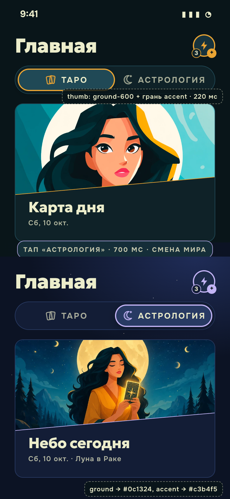
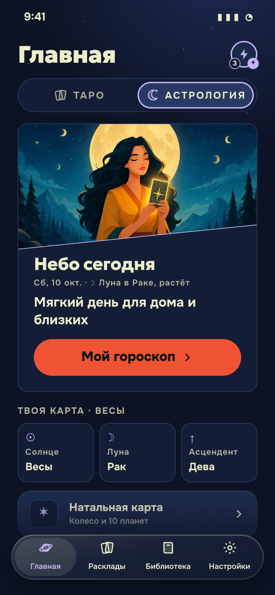
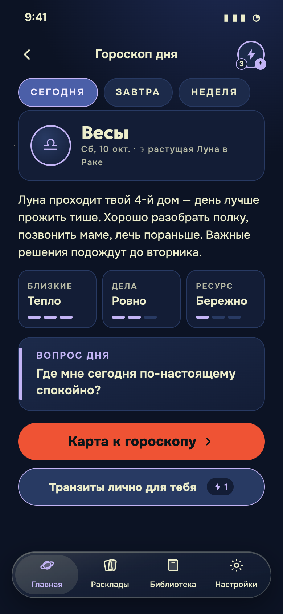
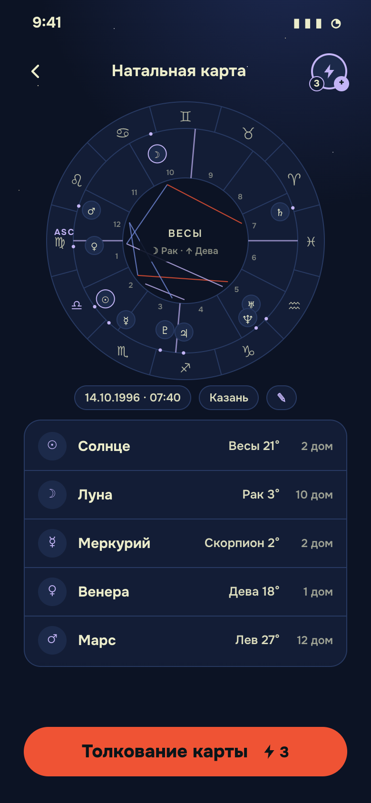

# Mindful Tarot × Астрология


Продуктовый ресерч и план интеграции Астрологии в приложение · октябрь 2026


# Сводка

Документ собран из трёх частей. Продакт-менеджер отвечает за рынок, конкурентов, фичи и аналитику. UX/UI — за то, как разделить Таро и Астрологию и как это выглядит. Тимлид — за то, как это встраивается в код. Ниже — общие решения. Там, где роли расходились, решение принято здесь и имеет приоритет над частями.

## Главное в пяти пунктах

1. **Астрология — второй «мир» рядом с Таро, но с общим кошельком и мостами в Таро.** Пользователь переключается между мирами одной кнопкой. Внутри Астрологии каждый экран ведёт обратно в платное Таро: «карта к гороскопу», «Для влюблённых» из совместимости, расклады в новолуние.
2. **Переключение — сегмент «Таро | Астрология» в шапке Главной.** При переключении за 700 мс меняется небо: лес становится индиго, горчичный акцент уходит в лаванду. Таб-бар остаётся с четырьмя вкладками, у Астрологии свой адрес `/astro/*`, приложение помнит последний выбранный мир. Это прямое воплощение идеи «блок, который разделяет темы, и кнопка перехода». Остальные четыре концепта разобраны в части UX и отклонены.
3. **Вход без барьера.** Для знака и гороскопа хватает даты рождения. Время и город нужны только для натальной карты, и мы честно говорим: «время неизвестно — покажем то, что точно». Профиль собирается по уровням L0–L3.
4. **Бесплатное удерживает, платное углубляет.** Бесплатно: гороскоп дня по знаку, Луна, совместимость знаков, колесо натальной карты и «большая тройка». За заряды: полный AI-портрет по натальной карте, синастрия пары, персональные отчёты. Подписки нет, ⚡ те же, что в Таро.
5. **Технически это недорого и безопасно.** Движок `astronomy-engine` (лицензия MIT) на сервере. Swiss Ephemeris не берём: у неё AGPL или платная лицензия. Гороскоп генерируется один раз на знак, день и язык — это 24 генерации в сутки на всех пользователей. Даты рождения не уходят третьим лицам: в OpenAI отправляем только знаки и позиции планет.

## Решения по расхождениям между ролями

| Вопрос | Продакт | Тимлид / UX | Решение |
|---|---|---|---|
| Что в MVP | Без новых вызовов LLM, астрология как слой внутри Таро | Отдельный мир `/astro` и гороскоп дня по знаку (AI, кэш) | **Отдельный мир с переключателем.** Это идея владельца, а 24 генерации в сутки стоят копейки. Слой контекста продакта тоже берём: знак в толковании раскладов, «небо дня» в карте дня |
| Цена полного портрета по натальной карте | ⚡3 разово, хранится навсегда | Первый бесплатно, дальше ⚡2 | **⚡3 разово**, без бесплатного первого раза: это главный платный артефакт ниши. «Большая тройка» и колесо — бесплатно |
| Синастрия пары | ⚡2, бесплатный тизер из двух пунктов | Первый бесплатно, дальше ⚡2 | **⚡2 с бесплатным тизером.** Бесплатный первый раз не даём, иначе обесценим расклад «Для влюблённых» за ⚡2 |
| Персональный день (транзиты к натальной карте) | В v3 как месячный отчёт за ⚡3 | ⚡1 в день | **Месячный отчёт за ⚡3 в v3.** Ежедневная плата за ⚡1 отнимает у пользователя бесплатный тарошный слот (риск каннибализации) |
| Совместимость в процентах | Без процентов | Без процентов | Согласны: только описание стихий и тем, **без процентов и звёздочек** |
| Название в коде | — | `section` (у тимлида), `data-world` (у UX) | **`section`** и атрибут `data-section`. Слово `theme` уже занято светлой и тёмной темой |

## Дорожная карта

| Этап | Срок | Что получает пользователь |
|---|---|---|
| **MVP** | ~12 человеко-дней (2,5–3 недели с тестами и ревью) | Переключатель миров, астро-профиль (дата, по желанию время и город), гороскоп дня по знаку, Луна сегодня, справочник знаков, совместимость знаков, знак в толковании раскладов, «небо дня» в карте дня, гороскоп в утреннем сообщении бота в 10:00 |
| **v2** | ~11 человеко-дней | Натальная карта: колесо, большая тройка бесплатно, полный портрет за ⚡3. Знаки пары в «Для влюблённых», лунный календарь ритуалов, нумерология по дате |
| **v3** | ~10 человеко-дней | Синастрия пары (⚡2, приглашение по ссылке), месячный транзит-отчёт (⚡3), «год в картах» ко дню рождения (⚡5), пуши о новолунии и полнолунии, шеринг гороскопа в сторис |

## Что нужно решить владельцу до старта

1. **Юридическое.** Дата и место рождения — персональные данные (152-ФЗ). С 1 сентября 2025 года согласие оформляется отдельным документом. Нужно проверить у юриста, где хранятся данные в Supabase и нужны ли серверы в РФ.
2. **Иллюстрации.** Нужны 3–4 обложки астро-мира в стиле текущих. Промпты — в части UX, раздел 3.
3. **Цены в зарядах** из таблицы выше — гипотезы. Их стоит проверить через A/B-тесты, гипотезы перечислены в части продакта, раздел 7.


# Часть 1. Продукт: рынок, конкуренты, фичи

Октябрь 2026. Основа — поиск по рынку и два внутренних отчёта: «продуктовый ресерч таро и wellness» и «growth features». Метки доказательств: **[данные]** — опубликованные цифры, **[вендор]** — цифры продавца, агентства или маркетингового блога, **[гипотеза]** — суждение без замера.

## Коротко

1. **Астрологию не стоит делать вторым продуктом рядом с таро. Это слой контекста** для того, что уже есть: карты дня, «Зеркала недели», раскладов «Для влюблённых», привычек. Главный довод — время рождения нужно для натальной карты, а знает его меньшинство. Если вход в астрологию — сразу натальная карта, большинство на нём отвалится.
2. **Рынок растёт за счёт AI-персонализации.** Глобальная выручка астро-приложений в 2025 году оценивается в $4,7–7,1 млрд, рост 8–20% в год. В RuStore загрузки астро- и таро-приложений за январь–июль 2026 выросли на 96%, и магазин прямо связывает рост с AI. При этом трафик на сайты эзотериков в РФ падает на 25–38%. Значит, растёт формат «персонально и в телефоне», а не интерес к эзотерике в целом.
3. **Слабое место конкурентов — тон и биллинг.** Nebula и The Pattern ругают за скрытое автопродление и сложную отмену. Co–Star ругают за то, что совместимость ушла за пейволл. Наша модель зарядов без подписки и спокойный тон закрывают ровно эти претензии.
4. **MVP за 3–4 недели без новых вызовов LLM:** знак по дате, фаза Луны и луна в знаке, строка «небо дня» в карте дня, лунные ритуалы, совместимость по знакам в раскладе «Для влюблённых». Платное — в v2: натальная карта, синастрия, месячный транзит-отчёт.
5. **Главные риски:** тон («плохой транзит» = запугивание), лицензия эфемерид (Swiss Ephemeris идёт под AGPL или за 700 CHF; MIT-альтернатива — astronomy-engine) и 152-ФЗ. С 1 сентября 2025 года согласие на обработку персональных данных оформляется отдельным документом, штраф за нарушение — до 700 тыс. ₽.

---

## 1. Рынок: размер и тренды 2024–2026

| Показатель | Значение | Источник |
|---|---|---|
| Глобальный рынок астро-приложений | $4,73 млрд (2025) → $5,69 млрд (2026), CAGR ~20%, $11,7 млрд к 2030 | The Business Research Company / Report Cubes [вендор] |
| Альтернативная оценка | $7,11 млрд (2025) → $13,48 млрд к 2032, CAGR 8,4% | MarkNtel Advisors [вендор] |
| Модели и регионы (2026) | Western astrology ~50% рынка, freemium ~45%, APAC ~38% | MarkNtel [вендор] |
| Co–Star | ~4,3 млн MAU; летом 2026 куплен Midjourney | Bloomberg, Engadget [данные] |
| Nebula (OBRIO) | ARR $50 млн и 30 млн пользователей (2023); 60+ млн пользователей, 5 млн консультаций, MAU в 2025 году вырос более чем вдвое | tech.eu, Wikipedia [данные компании] |
| AI-новички в США | Starla — 430 тыс. загрузок в неделю, $2,18 млн в месяц (2025) | devtechnosys [вендор, не проверено] |
| РФ, RuStore | 103 тыс. загрузок астро- и таро-приложений за январь–июль 2026, +96% г/г; в топе «Гороскопы» VK, «Мой гороскоп», AxioNika (AI), «Матрица судьбы» | The Moscow Times со ссылкой на RuStore [данные] |
| РФ, веб | Трафик сайтов эзотериков и астрологов −25% в 2025 году, −31–38% в январе–феврале 2026 | MenToday [данные] |
| РФ, вера | Верят гороскопам 15% (было 31% в 2015 году); среди 18–24 лет — 27%, среди женщин — 21% | ВЦИОМ через Сноб [данные] |
| РФ, Telegram-боты | Крупные гадальные боты зарабатывают до ~50 млн ₽ в месяц; простой расклад от 50 Stars (~85 ₽) | Коммерсантъ [данные, оценка рынка] |

**Что растёт:**

- **AI-астролог и чат.** Пользователи ждут ответа на свой вопрос, а не текста «для всех Скорпионов». В RuStore это основная причина роста [данные].
- **Совместимость и социальная астрология.** Друзья и пары — исторический вирусный крючок Co–Star. В 2026 году его закрыли за Plus, и это стало главной претензией к приложению [вендор].
- **Натальная карта как «психологический портрет».** На этом построены The Pattern и CHANI. В РФ к ним добавляется нумерология: «Матрица судьбы» по одной дате рождения, без времени, в топе RuStore [данные]. Нумерологию стоит рассматривать как соседний вход.
- **Луна и ритуалы.** Moonly, CHANI. Продаёт ритм, а не предсказание.
- **Живые эксперты за минуты** (Nebula, Sanctuary, Hint). Высокий ARPU, но это маркетплейс и вопрос репутации. Нам не подходит.

**Вывод для нас:** интерес к астрологии как к «вере» снижается, а спрос на персональные AI-тексты растёт. Это совпадает с mindful-позиционированием: «язык для саморефлексии», а не «звёзды решат».

---

## 2. Конкуренты

| Продукт | Ключевые фичи | Монетизация и цены | Сильное | Слабое | Что взять |
|---|---|---|---|---|---|
| **Co–Star** | Ежедневный пуш, натальная карта (NASA-данные + AI + редакторы), друзья, совместимость, транзиты | Free + Plus (подписка); отчёт совместимости £8,99 | Узнаваемый голос, минимализм, вирусность «добавь друга» | Совместимость за пейволлом, 2–3 пуша в день, падения в «громкие» астро-дни; Google Play ~3,9 | Совместимость с другом через приглашение. Короткая фраза дня с характером |
| **The Pattern** | Психологичные тексты по карте, «паттерны» отношений, совместимость | Go Deeper+ от $14,99/мес; 3 профиля для сравнения $9,99 | Тексты «про меня, а не про звёзды» | Сложная отмена, «случайные» оценки совместимости, повторы | Психологическая рамка без жаргона. Разовая покупка профиля партнёра |
| **Sanctuary** | Ежедневные чтения, чат и видео с астрологами | Подписка + поминутная оплата | Сеть астрологов | Таймер идёт во время ожидания, очереди 20–45 мин, путаница кредитов и подписки; Google Play ~3,5 | Ничего из модели. Урок: не смешивать две валюты |
| **Nebula** | Гороскопы, совместимость, хиромантия, чат с «психиками» | Триал 3 дня → $9,99/нед; чат поверх | Перформанс-маркетинг, масштаб | Скрытое автопродление, отказы в рефанде, шаблонные прогнозы | Онбординг-квиз, который «рисует портрет» до регистрации. Антипример биллинга |
| **CHANI** | Гороскопы, фазы Луны с практиками, ретрограды, подкаст, обзор карты | Free; премиум $11,99/мес или $107,99/год | Самый близкий нам тон: забота, практики, без страха | Дорого для РФ, только английский | Луна как практика. «Что делать» вместо «что будет» |
| **Moonly** | Лунный календарь, ритуалы, таро, аффирмации, медитации, сонник | $4,99/нед, $9,99/мес, $44,99/год, lifetime $39,99 | Связка луны, ритуала и таро — прямой аналог нашей идеи | Перегружено, агрессивный недельный тариф | Лунный календарь ритуалов + таро |
| **Hint** | AI-гороскопы, карта, таро, совместимость, курсы, чат с астрологом | Подписка; главная ценность — живой чат | Пакет «всё включено» | Размытая ценность без чата | — |
| **TimePassages** | Профессиональная натальная карта, транзиты, прогрессии | Своя карта бесплатно, другие по $0,99 за штуку, подписка для безлимита | Точность и доверие «астрологов-гиков» | Сложный UX для новичков | Поштучная оплата дополнительных карт — ложится на заряды ⚡ |
| **Astroline / Astro Line** | AI-гороскоп, нумерология, таро, хиромантия | Недельные подписки $6,99–9,99 | AI «всё в одном» | Тот же «пейволл с недельным триалом», что у Nebula | — |
| **Stellium** | Глубокий анализ карты: астероиды, мидпойнты | Разовая покупка | Отзывы о разовой оплате заметно теплее | Мало ежедневного контента | Разовая оплата повышает доверие |
| **«Гороскопы» VK / horo.mail.ru** | Ежедневный гороскоп по знаку, персональная страница по дате рождения для авторизованных | Реклама | Охват, топ RuStore | Общий текст по знаку, нет связи с жизнью пользователя | Персонализация по дате без лишних вопросов |
| **Рамблер/гороскопы** | Гороскопы, спецпроекты (музыкальный гороскоп со «Звуком») | Реклама, партнёрства | Медийный охват | Нет продукта, есть контент | Спецпроекты к сезонам |
| **Нейродзен, AI-Астролог, AxioNika** (RuStore) | Натальная карта за 2 минуты по дате, времени и месту; AI-разбор | Подписки и разовые отчёты | AI-тексты на русском | Обещания «судьбы», тон предсказаний | Скорость: от ввода до первого инсайта меньше минуты |
| **Telegram-боты: гороскопы, «Матрица судьбы», нумерология** | Расчёт по дате, отчёты, совместимость | Stars, от 50 ⭐ за отчёт; VIP до 10 000 ₽ | Ноль трения, нативная оплата | Шаблонный AI, нет памяти, «эзотерическая вода» | Цены в Stars. Короткий бесплатный «тизер» и платная полная версия |

**Позиция Mindful Tarot:** единственный продукт в РФ-сегменте, где таро, Луна, настроение и привычки собраны в одном аккаунте с памятью и спокойным тоном, без подписки. Ближайший смысловой конкурент — CHANI, но у CHANI нет русского языка, нет Telegram, а цена — $12 в месяц.

---

## 3. Синергия Таро + Астрология

Принцип: астрология — **контекст** для карты, а не замена ей. Карта остаётся главным ответом, небо добавляет «погоду» дня.

| Связка | Как выглядит | Почему работает |
|---|---|---|
| **Карта дня + «небо дня»** | Под картой дня одна строка: «Луна в Раке — день про дом и заботу о себе. Карта: Королева Кубков». Связка без AI: таблица соответствий «знак Луны → тема» | Карта дня становится разнообразнее (боль №3 из wellness-ресерча), повод открыть приложение каждый день |
| **Знак в толковании** | В промпт расклада добавляется «пользователь — Телец (Солнце), Луна в Деве (если известна)». Модель вплетает это одной фразой, без жаргона | Персонализация без нового вызова, только +30 токенов на вход |
| **Астрологические соответствия карт** | Каждый аркан имеет классическое соответствие (Золотая Заря): Императрица — Венера, Колесница — Рак, двойки Жезлов — Марс в Овне. В карточке словаря: «Это твоя карта: Солнце в Раке ↔ Колесница» | «Своя карта» по знаку — эмоциональная связка, нужна только дата рождения. Контент статический, LLM не нужен |
| **Совместимость + «Для влюблённых»** | Перед раскладом на двоих — мини-экран «Овен + Весы: огонь и воздух». После — расклад, который уже учитывает это | Апгрейд существующей платной фичи ⚡2, поднимает ценность и шеринг |
| **«Для друзей» + совместимость** | Пригласить подругу → у обеих знаки → карточка «наша стихия» + совместный расклад | Соцпетля как у Co–Star, но бесплатная в базе |
| **Лунный цикл + привычки** | Новолуние: расклад-намерение → привычка на цикл. Полнолуние: расклад-итог с отсылкой к намерению. Убывающая Луна: «что отпустить» | Закрывает теорию Т4 (циклы без стриков) из wellness-ресерча. Луна считается без данных пользователя |
| **Ретроградный Меркурий без паники** | 3–4 раза в год баннер «Сезон пересмотра»: расклад «что перепроверить», практика «закрыть хвосты». Без «всё сломается» | Пик поискового интереса в эти периоды [гипотеза]. Подаём как повод для рефлексии |
| **Зеркало недели + небо** | «На этой неделе Луна прошла через твой знак — в эти дни настроение было выше/ниже» | Связка уже накопленных данных о настроении с астрологией. Если корреляции нет, честно молчим |
| **Сезон знака** | Каждые ~30 дней «сезон Скорпиона»: тематический расклад и карта, в свой сезон — «соляр» (расклад на год жизни) | Повод вернуться раз в месяц и дорогой платный продукт раз в год (день рождения) |

---

## 4. Фичи и приоритеты

### Градация точности профиля

| Уровень | Что ввёл пользователь | Что можно посчитать | Ограничения |
|---|---|---|---|
| **L0** | Ничего | Луна (фаза, знак), ретрограды, сезон знака | Не персонально |
| **L1** | Дата рождения | Знак Солнца (на «пограничных» датах 19–23 числа знак может зависеть от времени), «твоя карта» таро, числа нумерологии, совместимость по стихиям | Знак Луны точен не всегда: она меняет знак каждые ~2,5 дня |
| **L2** | Дата + примерное время («утро / день / вечер / ночь» или ±2 ч) + город | Знак Луны (почти всегда), планеты в знаках | Асцендент и дома ненадёжны: асцендент меняет знак примерно каждые 2 часа |
| **L3** | Дата + точное время (±15 мин) + город | Полная натальная карта: асцендент, дома, аспекты, транзиты к натальной карте | Нужен исторический часовой пояс (декретное и летнее время в СССР) по IANA tzdb |

В интерфейсе честно: «время неизвестно — покажем то, что точно». Карта уровня L3 отмечена значком «точная». Время рождения есть в свидетельстве о рождении — это даёт хорошую подсказку для пуша «найди время и открой асцендент». Публичных данных о том, какая доля людей знает своё время рождения, мы не нашли. Закладываем, что меньшинство [гипотеза], и проверяем это в своём онбординге.

### MVP (3–4 недели, без новых LLM-вызовов)

| Фича | Ценность | Вход | Сложность | ⚡ | Метрика успеха |
|---|---|---|---|---|---|
| **Астро-профиль L1** (дата рождения, знак, «твоя карта» таро) | «Приложение знает меня» | Дата | S | Бесплатно | ≥50% DAU заполнили дату за 14 дней |
| **Небо дня в карте дня** (фаза Луны, Луна в знаке, строка-тема) | Разнообразие ежедневного ритуала | L0 | S | Бесплатно | D7 retention +2 п.п. против контроля |
| **Знак в промпте расклада** | Более личное толкование | L1 | S | Не меняет цену | Оценка толкования 👍, доля дочитавших |
| **Лунный календарь ритуалов** (новолуние / полнолуние: расклад-намерение и расклад-итог, привычка на цикл) | Ритм без стриков | L0 | M | Расклад-намерение — дневной бесплатный слот или 1⚡; итог в полнолуние бесплатно, если было намерение | Открытия в дни фаз против фона; доля намерение → итог ≥25% |
| **Совместимость по знакам в «Для влюблённых»** (стихии, модальности, 3 короткие строки) | Апгрейд платного расклада, шеринг | L1 у обоих (дату партнёра вводят на одном телефоне) | S | Мини-экран бесплатно, расклад ⚡2 как сейчас | Конверсия в «Для влюблённых» +15%, шеринги |
| **Утренний пуш в 10:00 с небом дня** (вариант текста бота) | Повод открыть | L0/L1 | S | Бесплатно | CTR пуша против текущего текста |

### v2 (1–2 месяца после MVP)

| Фича | Ценность | Вход | Сложность | ⚡ | Метрика |
|---|---|---|---|---|---|
| **Натальная карта L2/L3**: колесо + «большая тройка» (Солнце, Луна, асцендент) бесплатно, полный AI-портрет по 10 планетам — платно | Глубокий «портрет» — главный ожидаемый продукт ниши | L2/L3 + город (геокодер по GeoNames cities15000, офлайн) | L (эфемериды, часовые пояса, колесо, промпт) | Тройка бесплатно; полный портрет **3⚡** разово, хранится навсегда | Доля L3 среди профилей; конверсия тройка → портрет ≥5% |
| **Синастрия пары** (аспекты между двумя картами, AI-текст «как вы дополняете друг друга») | Совместимость глубже знаков | L2+ у обоих | M | **2⚡**; бесплатно — тизер из 2 пунктов | Покупки синастрии, приглашения партнёра |
| **Совместимость с подругой по приглашению** | Вирусная петля | L1 у обеих | M | Бесплатно; углублённый расклад «Для друзей» — как сейчас | K-фактор, установок с одного приглашения |
| **Ретроградный Меркурий / сезоны знаков** — тематические расклады | Событийные пики | L0 | S | Тематический расклад — обычная цена | Пики DAU в эти периоды |
| **Нумерология по дате** (число пути, личный год) | Вход для тех, кто про «Матрицу судьбы» | L1 | S | Бесплатно базово | Доля трафика из этого входа |

### v3 (квартал+)

| Фича | Ценность | Вход | Сложность | ⚡ | Метрика |
|---|---|---|---|---|---|
| **Личный транзит-отчёт на месяц** (3–5 главных транзитов к натальной карте + расклад на месяц) | Ритм «глава месяца» | L3 | L | **3⚡** | Повторная покупка в следующий месяц ≥20% |
| **Соляр / «год в картах» к дню рождения** | Подарочный момент, раз в год | L1–L3 | M | **5⚡** или подарок другу (уже есть механика подарка) | Покупки в окне ±7 дней от ДР |
| **Транзит дня в «Зеркале»** (корреляция настроения с Луной и транзитами) | Ценность накопленных данных | L2+ и 30+ дней настроения | M | Бесплатно | Возвраты в воскресенье |
| **Уточняющий вопрос к натальной карте** | Диалог | L3 | M | 1⚡ за вопрос | Средний чек |

**Экономика AI.** Тарифы gpt-4o-mini — примерно $0,15 за 1 млн входных токенов и $0,60 за 1 млн выходных. Портрет на ~2 тыс. токенов входа и ~2 тыс. выхода стоит около $0,0015, то есть 0,1–0,2 ₽. Даже с запасом в 10 раз это копейки на фоне цены заряда (~25–43 ₽). Главная статья затрат — разработка, а не токены. Портрет и синастрию генерируем один раз и кэшируем по хэшу входных данных.

---

## 5. Онбординг, retention, виральность

### Онбординг астро-профиля

Принцип: **дату спрашиваем только тогда, когда она сразу что-то даёт.** Регистрацию не трогаем.

1. **Триггер в контексте.** После первой карты дня: «Хочешь, покажу, какая карта таро — твоя по знаку?» → одно поле даты (пикер «день / месяц / год», год можно пропустить: для знака он не нужен). Результат в ту же секунду: «Ты Рак ♋ → твоя карта Колесница».
2. **Уровень L2 — по ценности.** Из карточки знака: «Узнать свою Луну — эмоциональный знак. Нужен час рождения, можно примерно». Варианты: «точно знаю», «примерно» (4 интервала), «не знаю». Последний вариант не наказывается.
3. **Уровень L3 — когда нужна натальная карта.** Город с автодополнением и время. Подсказка: «время указано в свидетельстве о рождении».
4. **Партнёр — в «Для влюблённых».** К имени добавляется необязательная дата. Хранится только у пользователя, без аккаунта партнёра.
5. **Согласие.** Отдельный чекбокс и ссылка на отдельный документ согласия (см. риски). Формулировка: «Дату используем только для твоих толкований, можно удалить в любой момент».

### Retention-механики

| Механика | Частота | Деталь |
|---|---|---|
| Пуш в 10:00 | Ежедневно | Текст: «Луна в Раке 🌙 Какая карта поддержит тебя сегодня?» вместо «Погадаем?». Есть выключатель и опция «только фазы Луны» |
| Фазы Луны | 2 раза в месяц | Новолуние — намерение, полнолуние — итог. Отдельный пуш, только с согласия |
| Сезон знака | Ежемесячно | Тематический расклад; в свой сезон — персональное поздравление и предложение «год в картах» |
| Ретроград | 3–4 раза в год | «Сезон пересмотра»: практика + расклад |
| День рождения | Раз в год | Подарочный заряд от нас + соляр |

Ограничение: не больше одного пуша в день от бота. Co–Star ругают именно за 2–3 пуша в день.

### Виральность

- **Карточка совместимости для сторис** (9:16): два знака, стихии, одна тёплая фраза и карта таро пары, плюс deeplink `startapp=compat_<id>`. Открывший вводит свою дату и сразу видит совместимость с отправителем.
- **«Мой знак в таро»** — карточка «Я Скорпион, моя карта — Смерть (трансформация, не конец)». Хорошо ложится на TikTok-формат «твоя карта по знаку зодиака».
- **Сезонный контент для TikTok:** 12 роликов «карта сезона для каждого знака» — дешёвый органический трафик, ведёт на `startapp=sign_<знак>`.
- **Приглашение подруги** → обе получают бесплатный совместный мини-расклад.

---

## 6. Риски

| Риск | Суть | Что делаем |
|---|---|---|
| **Точность расчётов** | Ошибка в эфемеридах, часовых поясах (декретное время СССР, смены поясов в регионах РФ) или геокоординатах даёт неверный асцендент. Это видно «знающим» пользователям и бьёт по доверию | Эфемериды: **astronomy-engine** (MIT, точность ±1′, проверен по JPL Horizons) для планет и Луны. Swiss Ephemeris — только по лицензии: AGPL обязывает открыть код всего сервиса, Professional License стоит 700 CHF. Часовые пояса — IANA tzdb (`Intl` / luxon). Дома — Placidus по своей формуле или Whole Sign как более простой и устойчивый вариант. Тест-набор из 50 эталонных карт (сверка с astro.com) |
| **Пограничные даты** | Знак Солнца 19–23 числа зависит от времени | Явно: «ты на границе Весов и Скорпиона — укажи время, чтобы уточнить» |
| **Тон и этика** | «Плохой транзит», «Сатурн разрушит отношения», «ретроград — не подписывай договоры» — это запугивание, тревожный цикл, конфликт с брендом | Гайд по тону и системный промпт: транзиты — «темы и вопросы», без предсказаний и оценок «плохо/хорошо». Стоп-лист фраз. Никаких медицинских, финансовых и юридических советов. Совместимость не бывает «несовместимы»: только «где легко, где нужна работа». Кризисные темы — стоп и контакты помощи (уже в плане growth) |
| **Совместимость ссорит пары** | «Нам 40% совместимости» — травмирует | Без процентов и шкал. Только качественные описания |
| **152-ФЗ** | Дата, время и место рождения в связке с Telegram ID — персональные данные. С 1 сентября 2025 года согласие оформляется отдельным документом. Штрафы с 30 мая 2025 года — 300–700 тыс. ₽ за обработку без надлежащего согласия, а за утечки — кратно выше | Отдельное согласие на астро-профиль. Данные партнёра — минимум (имя + дата) и только для расчёта у пользователя. Удаление профиля одной кнопкой. Хранение на серверах в РФ — проверить, где развёрнут Supabase, и при необходимости мигрировать. Уведомление РКН об обработке ПДн. В промпт OpenAI передаём **только знаки и позиции**, а не дату, место и имя — это и минимизация, и решение вопроса трансграничной передачи |
| **Стоимость AI** | Низкая (см. экономику), но длинные портреты и чаты могут вырасти | Кэш портретов, потолок токенов, ежедневные тексты — из шаблонов без LLM |
| **Распыление продукта** | Астрология съедает фокус до того, как сделаны память и ритуал из прошлых ресерчей | MVP строго как слой над картой дня и лунным ритуалом, который уже стоит в плане |
| **Платёжный комплаенс Telegram** | Цифровые товары в Mini App — через Stars | Новые астро-SKU продаются за ⚡, а ⚡ — через уже планируемую кассу (Stars в TMA, Lava на вебе) |

---

## 7. Аналитика: Яндекс.Метрика, воронка, A/B

### Цели Метрики (JS-события `reachGoal`)

| Цель | Событие |
|---|---|
| `astro_prompt_shown` | Показан оффер «твоя карта по знаку» |
| `astro_birthdate_saved` | Сохранена дата (L1) |
| `astro_birthtime_saved` | Сохранено время, параметр `precision=exact/approx/unknown` (L2/L3) |
| `astro_birthplace_saved` | Выбран город |
| `astro_consent_accepted` | Принято согласие на ПДн |
| `sky_today_view` | Просмотр блока «небо дня» |
| `moon_intention_start` / `moon_intention_done` | Расклад-намерение в новолуние |
| `moon_review_done` | Итог в полнолуние |
| `compat_view` | Экран совместимости |
| `compat_share` | Шеринг карточки, параметр `channel` |
| `compat_invite_open` | Открытие по deeplink `compat_` |
| `natal_preview_view` | Просмотр «большой тройки» |
| `natal_portrait_purchase` | Покупка портрета за ⚡ |
| `synastry_purchase` | Покупка синастрии |
| `astro_push_click` | Клик из пуша бота, параметр `push_type` (UTM в deeplink) |

Параметры визита: `astro_level` (L0–L3), `sun_sign`, `source` (TikTok, бот, invite). Знак Солнца и уровень не идентифицируют человека. Дату в Метрику не передаём.

### Воронка

1. Открыл карту дня → 2. Увидел оффер знака → 3. Сохранил дату (L1) → 4. Увидел «небо дня» 3+ дня из 7 → 5. Добавил время (L2/L3) → 6. Посмотрел большую тройку → 7. Купил портрет или синастрию за ⚡ → 8. Повторная астро-покупка.

Параллельная социальная воронка: показ совместимости → шеринг → открытие по ссылке → ввод даты новым пользователем → первая карта дня.

**Ориентиры [гипотеза, калибровать на первых 2 неделях]:** 2→3 ≥40%, 3→5 ≥25%, 6→7 ≥5%. Доля новых пользователей из `compat_invite_open` — ≥10% от всех новых.

### Гипотезы A/B

| # | Гипотеза | Вариант | Метрика |
|---|---|---|---|
| 1 | Спрашивать дату после первой карты дня конвертирует лучше, чем в онбординге | Оффер после карты против шага онбординга | Доля L1 к D7, D7 retention |
| 2 | «Небо дня» повышает возврат | С блоком против без | D7/D14 retention, частота открытий |
| 3 | Пуш с Луной кликают чаще, чем текущий | «Луна в Раке 🌙…» против текущего текста | CTR пуша, отписки |
| 4 | Знак в промпте повышает удовлетворённость | Промпт со знаком против без | 👍 толкования, повторный расклад за 3 дня |
| 5 | Тизер синастрии (2 пункта бесплатно) продаёт лучше, чем закрытый экран | Тизер против замка | Конверсия в покупку синастрии |
| 6 | «Примерное время» поднимает долю L2 без потери точности восприятия | 4 интервала против только точного времени | Доля L2+, жалобы на неточность |
| 7 | Цена портрета: 3⚡ против 5⚡ | — | Выручка на 100 L3-пользователей |
| 8 | Карточка «мой знак в таро» шерится чаще, чем карточка совместимости | Две карточки | Шеринги на 100 DAU, инсталлы по ссылке |

---

## Источники

**Рынок**
- MarkNtel Advisors — Astrology App Market 2026–2032: https://www.marknteladvisors.com/query/report-enquiry/astrology-app-market.html
- The Business Research Company / Report Cubes: https://www.giiresearch.com/report/tbrc1978437-astrology-app-global-market-report.html , https://www.thereportcubes.com/report-store/astrology-app-market
- Devtechnosys — astrology market statistics (Starla, Astro) [вендор]: https://devtechnosys.com/insights/astrology-market-statistics/
- Bloomberg Law — Midjourney buys Co–Star: https://news.bloomberglaw.com/private-equity/ai-lab-midjourney-buys-astrology-startup-co-star-plans-new-apps
- Engadget — Midjourney is buying Co–Star: https://www.engadget.com/2222797/midjourney-is-buying-horoscope-app-co-star/
- CB Insights — Co–Star: https://www.cbinsights.com/company/co-star-astrology-society
- tech.eu — OBRIO / Nebula: https://tech.eu/2023/12/05/obrio/
- Wikipedia — Nebula: https://en.wikipedia.org/wiki/Nebula_(spiritual_guidance)
- The Moscow Times — RuStore, +96% загрузок: https://ru.themoscowtimes.com/2026/08/14/rossiyane-bolshe-100-tisyach-raz-s-nachala-goda-skachali-prilozheniya-dlya-gadanii-i-goroskopov-a203559
- MenToday — спад спроса на эзотериков: https://www.mentoday.ru/entertainment/news/10-03-2026/konec-magicheskogo-buma-pochemu-v-rossii-padaet-spros-na-uslugi-ezoterikov-i-astrologov/
- Сноб — доверие к гороскопам (ВЦИОМ): https://snob.ru/news/za-sem-let-chislo-doveryayushih-goroskopam-rossiyan-sokratilos-v-dva-raza/
- Коммерсантъ — гадальные боты в Telegram: https://www.kommersant.ru/doc/8728135
- Harris Poll — Astrology Survey 2024: https://theharrispoll.com/wp-content/uploads/2024/02/Astrology-Survey-February-2024.pdf

**Конкуренты**
- Unstar — Co–Star, Sanctuary, Pattern, Nebula, Stellium ranked 2026 [вендор]: https://unstar.app/blog/co-star-sanctuary-pattern-nebula-stellium-astrology-apps-ranked-2026
- Bustle — The Pattern review: https://www.bustle.com/life/pattern-app-review-features-price
- Bustle — Moonly review: https://www.bustle.com/life/moonly-astrology-app-review
- CHANI — App Store: https://apps.apple.com/app/id1532791252
- Moonly — App Store: https://apps.apple.com/US/app/id1489889871 ; пейволл: https://adapty.io/paywall-library/moonly/
- Hint — обзор Film Threat: https://filmthreat.com/features/hint-app-review-features-astrologers-pricing-and-is-it-worth-it/
- TimePassages — цены: https://apppricinglab.com/app/apple/488946918
- Astro Line — App Store: https://apps.apple.com/us/app/-/id6744942993
- Леди Mail.ru — перезапуск гороскопов: https://lady.mail.ru/article/484217-novoe-na-ledi-perezapusk-goroskopov/
- Рамблер/гороскопы — RuStore: https://www.rustore.ru/catalog/app/ru.rambler.horoscopes.twa
- Нейродзен — RuStore: https://www.rustore.ru/catalog/app/ru.neurodzen.app
- AI-Астролог — RuStore: https://www.rustore.ru/catalog/app/com.aiastrologer.app
- Telemetr — каталог астро-каналов: https://telemetr.me/catalog/goroscop/astrologiya/

**Техника и право**
- Swiss Ephemeris — лицензии: https://www.astro.com/swisseph/sweph_p.htm ; цена: https://www.astro.com/swisseph/swephprice_e.htm
- RoxyAPI — AGPL для SaaS: https://roxyapi.com/blogs/swiss-ephemeris-agpl-licensing-saas
- Astronomy Engine (MIT): https://github.com/cosinekitty/astronomy
- Гарант — изменения 152-ФЗ: https://www.garant.ru/article/1862510/
- Налог-Налог — согласие отдельным документом с 1 сентября 2025: https://nalog-nalog.ru/personalnye_dannye/vazhnoe-utochnenie-po-personalnym-dannym-s-1-sentyabrya-2025-goda/
- РБК Компании — требования к ПДн на 2026: https://companies.rbc.ru/news/SZRjtRsMIn/novyie-trebovaniya-k-obrabotke-personalnyih-dannyih-polnyij-gajd-na-2026-god/
- Telegram — платежи Stars для цифровых товаров: https://core.telegram.org/bots/payments-stars


# Часть 2. UX/UI: как разделить Таро и Астрологию

Автор: UX/UI-ревью Mindful Tarot · 10.10.2026 · основа: `apps/web-vite` (токены `src/styles/tokens.css`, `shared/ui`, AppShell, Главная, каталог раскладов)

## 0. Что есть сейчас и на что опираемся

- **Навигация.** Плавающая стеклянная капсула внизу на 4 вкладки (Главная / Расклады / Библиотека / Настройки). На ширине от 900px вместо неё рейка слева. У «Главной» уже стоит иконка **планеты** (`PlanetIcon`), то есть «космос» в продукте уже обозначен.
- **Шапка корня таба.** `Header root`: крупный display-заголовок слева (Geologica Black 34), справа `ChargeMark ⚡` с числом зарядов и плюсом.
- **Фирменный приём.** Карточка-герой «Карта дня»: картинка сверху срезана по диагонали, по срезу рисуется линия-грань `accent-400` (анимация `dsDrawEdge`, 400 мс). Под ней заголовок, дата, лид и кнопка `action` (коралловая, `#ef5334`).
- **Палитра.** Ночной сине-зелёный «лес»: `ground-900 #091519` → `ground-600 #204956`. Акцент горчичный `#eaa433`, текст кремовый `#ecedcb`. Выбранное состояние: заливка `calm-600` плюс грань `accent`.
- **Иллюстрации.** Живописные сцены с героиней в горчичном халате, вокруг лес, горы и луна. Обложка `period_monthCard` (полная луна) уже почти астрологическая.

Ограничения: таб-бар уже полный, места под пятую вкладку нет. Приложение живёт и в Telegram Mini App, где мешают свайпы и цвет шапки задаёт Telegram. Тон спокойный: в продукте нет алармизма и «плохих дней».

## 1. Пять концептов переключения

### A. Сегмент «Таро | Астрология» в шапке Главной

```
┌──────────────────────────────────────┐
│ Главная                         (⚡3)│
│ ╭──────────────────────────────────╮ │
│ │[▯▯ ТАРО ]   ☾ АСТРОЛОГИЯ         │ │
│ ╰──────────────────────────────────╯ │
│ ┌──────────────────────────────────┐ │
│ │      (иллюстрация мира)          │ │
```

Под заголовком «Главная» стоит сегмент-капсула высотой 48 px. Бегунок сделан как выбранный `Chip`: заливка `ground-600`, грань `accent-400`. Тап переключает содержимое главной между мирами.

- **Плюсы.** Это ровно то, что описал владелец: блок разделяет темы, кнопкой между ними переходят. Таб-бар не меняется. Паттерн знаком всем (iOS segmented control). На любой ширине видно, в каком ты мире.
- **Минусы.** Сегмент занимает около 64 px вертикали на главной. Астрология оказывается «внутри Главной», и до глубоких экранов на один тап дальше.
- **Навигация.** Мир отдельно от вкладок. Астро-экраны (`/astro/*`) подсвечивают таб «Главная».
- **Риски.** Можно не заметить, что сегмент вообще есть. Решается одноразовым бейджем «Новое» на сегменте и смене палитры: разницу видно сразу.
- **Telegram.** Работает без конфликтов. При смене мира вызываем `setHeaderColor`/`setBackgroundColor` и `HapticFeedback.selectionChanged()`.
- **Десктоп.** Сегмент в шапке шириной до 360 px, слева под заголовком. Сетка главной 7:5 сохраняется.

### B. «Два мира»: сплит-блок с двумя карточками-порталами

```
│ ┌───────────────┐ ┌────────────────┐ │
│ │  (героиня     │ │  (героиня и    │ │
│ │   с картой)   │ │   луна)        │ │
│ │ ТАРО          │ │ АСТРОЛОГИЯ     │ │
│ │ Карта дня ›   │ │ Небо сегодня › │ │
│ └───────────────┘ └────────────────┘ │
```

Наверху главной две равные карточки-портала с диагональным срезом, которые зеркалят друг друга.

- **Плюсы.** Самый «красивый», витринный вариант, хорошо работает на вовлечение и показывает обе темы одновременно.
- **Минусы.** Это не переключатель, а развилка: после входа в портал непонятно, как вернуться и где теперь «дом». Обе карточки по 160 px шириной, «Карта дня» теряет крупного героя, а это главный ежедневный крючок и ключ к удержанию.
- **Навигация.** Главная превращается в хаб, а каждый мир в отдельный стек экранов.
- **Риски.** Таро размывается, теряется фокус на ежедневном действии.
- **Telegram и десктоп.** На десктопе выглядит отлично (две колонки), на телефоне тесно.

### C. Отдельная вкладка «Небо» в таб-баре

```
│ ╭──────────────────────────────────╮ │
│ │ Главн Расклады  Небо  Библ  Наст │ │
│ ╰──────────────────────────────────╯ │
```

- **Плюсы.** Астрология всегда в один тап, это прямая и честная информационная архитектура.
- **Минусы.** Пять вкладок в плавающей капсуле: подписи сжимаются до 11 px и обрезаются («Библиотека»), зоны тапа около 70 px. Нарушается визуальный ритм капсулы.
- **Навигация.** Получаются два параллельных «дома» (Главная и Небо), и непонятно, куда ведёт пуш «Небо сегодня».
- **Риски.** Перегруз таб-бара и эффект «приложение для всего». Если астрология не взлетит, вкладку придётся убирать, а это болезненно.
- **Telegram.** На узких Android-экранах (360 px) капсула из 5 элементов выглядит тесно.

### D. Тумблер «карта/луна» в шапке с глобальной сменой палитры

```
│ Главная                  (▯|☾) (⚡3)│
```

Круглый тумблер рядом с ⚡. Тап анимированно меняет палитру всего приложения: лес становится ночным небом, горчица становится лавандой, и все вкладки переключаются на контент выбранного мира.

- **Плюсы.** Сильный вау-эффект и компактность. Ощущение двух миров одного приложения.
- **Минусы.** Иконка без подписи непонятна. Глобальная смена мира затрагивает «Расклады», «Библиотеку», «Настройки», то есть все экраны нужно делать в двух версиях. Тумблер легко нажать случайно.
- **Риски.** Пользователь «потерял» Таро: открыл Расклады и видит натальные карты. Поддержка спрашивает «куда делись расклады?».
- **Telegram.** Тумблер на 38 px рядом с ⚡ стоит в зоне, где у Telegram своё меню («⋯» в fullscreen-режиме), есть риск перекрытия.

### E. Свайп между мирами

Главная становится горизонтальным пейджером на два экрана с точками-индикаторами, свайп влево открывает Астрологию.

- **Плюсы.** Физично и приятно, анимация бесплатна, смена палитры привязана к прогрессу свайпа.
- **Минусы.** Свайп не находят: без подсказки им пользуются немногие. Он конфликтует с горизонтальной каруселью «Популярные расклады» на главной и с системным жестом «назад» в iOS.
- **Telegram.** Жесты Mini App (вертикальное сворачивание) плюс горизонтальный пейджер дают дребезг и ложные срабатывания.
- **Десктоп.** Свайпа нет, нужны стрелки, и паттерн разваливается.

### Сравнение

| Критерий | A Сегмент | B Порталы | C Вкладка | D Тумблер | E Свайп |
|---|---|---|---|---|---|
| Совпадает с идеей владельца | ●●● | ●● | ● | ●●● | ●● |
| Понятность с первого взгляда | ●●● | ●●● | ●●● | ● | ● |
| Таб-бар не трогаем | ●●● | ●●● | — | ●●● | ●●● |
| Таро остаётся ядром | ●●● | ● | ●● | ● | ●● |
| Telegram Mini App | ●●● | ●●● | ●● | ●● | ● |
| Десктоп | ●●● | ●●● | ●●● | ●● | ● |
| Стоимость реализации | низкая | средняя | средняя | высокая | средняя |

## 2. Рекомендация: «сегмент + смена неба» (A с лучшим из D и B)

Берём **сегмент A** как основной элемент управления: он подписан, его видно, он не ломает таб-бар. От **D** берём смену палитры, но только в пределах астро-мира, а не всего приложения. От **B** берём одноразовый портал-анонс на Таро-главной («Новое: твоё небо ›») для первого знакомства.

Правила:

1. **Мир — это состояние главной и её подстека, а не всего приложения.** «Расклады» остаются таро-каталогом (там ядро монетизации), Библиотека и Настройки общие. В Библиотеку позже добавится чип-фильтр «Астрология» (знаки, планеты, дома).
2. **У мира есть адрес.** Астро-главная живёт на роуте `/astro`, экраны на `/astro/horoscope`, `/astro/natal`, `/astro/pair`, `/astro/moon`. Сегмент делает `navigate('/astro', { replace: true })`. Работают кнопка «назад», диплинки из бота и пуша, а `isActive` таба «Главная» дополняется `p.startsWith('/astro')`.
3. **Выбор запоминается.** Последний мир хранится в профиле (и в `localStorage` как кэш). Тап по табу «Главная» открывает мир, в котором пользователь был последним. Пуш «Небо сегодня» в слот 10:00 МСК ведёт сразу в `/astro/horoscope`.
4. **Один кошелёк.** `ChargeMark ⚡` общий и стоит на том же месте. В астро-мире он перекрашивается в лаванду сам, потому что берёт `accent-400`.



### 2.1 Астро-палитра и токены

Смысл: таро — это **лес в сумерках** (сине-зелёный и горчица), астрология — **ночное небо** (индиго и лунная лаванда). Кремовый текст и коралловая кнопка `action` остаются общими: это ДНК бренда, и благодаря им переход читается как смена неба над тем же приложением, а не как другой продукт.

Реализация почти бесплатная: под `[data-world='astro']` переопределяем **те же ролевые переменные**, и все компоненты `shared/ui` (Button, Chip, ListRow, Tile, ChargeMark, ModalSheet) перекрашиваются без единой правки.

```css
/* Новые исходные токены (DS §02, раздел «Мир Астрология») */
:root {
  --ds-astro-ground-900: #0c1324; /* холст: ночное небо */
  --ds-astro-ground-800: #131d36; /* карточки */
  --ds-astro-ground-700: #1c2a4a; /* строки, чипы */
  --ds-astro-ground-600: #283a63; /* границы, бегунок */
  --ds-astro-calm-600:   #4b5fa8; /* выбранный чип */
  --ds-astro-calm-500:   #6f86d6; /* фокус, гармоничные аспекты */
  --ds-astro-accent-400: #c3b4f5; /* лунная лаванда: грань, иконки */
  --ds-astro-star:       #f1e6c4; /* звёзды, Солнце/Луна на колесе */
  --ds-astro-glow: radial-gradient(120% 60% at 80% -10%, #1f2c57 0%, transparent 60%);
}
:root[data-world='astro'] {
  --ds-ground-900: var(--ds-astro-ground-900);
  --ds-ground-800: var(--ds-astro-ground-800);
  --ds-ground-700: var(--ds-astro-ground-700);
  --ds-ground-600: var(--ds-astro-ground-600);
  --ds-calm-600:   var(--ds-astro-calm-600);
  --ds-calm-500:   var(--ds-astro-calm-500);
  --ds-accent-400: var(--ds-astro-accent-400);
  --ds-on-calm:    #f1ecff;
  --ds-skeleton-base: #1c2a4a; --ds-skeleton-highlight: #283a63;
  /* action-500, ink-50/100 — без изменений */
}
:root[data-theme='light'][data-world='astro'] {
  --ds-ground-900: #eef0f7; --ds-ground-800: #e2e5f1;
  --ds-ground-700: #e2e5f1; --ds-ground-600: #cdd2e6;
  --ds-calm-600: #3e4f94;  --ds-calm-500: #4b5fa8;
  --ds-accent-400: #5a47a6; /* ≈6:1 на #e2e5f1 */
  --ds-ink-100: #1c2a4a;   --ds-ink-50: #131d36;
}
```

Контраст (тёмная тема): `#c3b4f5` на `#131d36` около 9:1, `#ecedcb` на `#131d36` около 14:1. Кнопка `action` на индиго выглядит даже чище, чем на лесе.

Цвета аспектов на колесе: гармоничные `calm-500 #6f86d6`, напряжённые `action-500 #ef5334` с прозрачностью 0.8, соединения `accent-400`. Чистый красный не используем, чтобы напряжение не воспринималось как тревога.

### 2.2 Переход между мирами

| t, мс | Что происходит |
|---|---|
| 0 | `HapticFeedback.selectionChanged()`. Бегунок сегмента едет вправо (220 мс, `--ds-ease`), грань бегунка перетекает из горчицы в лаванду |
| 0–220 | Контент таро уходит: `opacity 1→0`, `translateX 0→-12px` |
| 0–700 | Цвета холста и поверхностей плавно интерполируются. Ролевые переменные регистрируются через `@property --ds-ground-900 { syntax: '<color>' }`, а при отсутствии поддержки поверх кладётся слой-оверлей цвета нового неба с fade |
| 120–700 | Проявляется звёздная пыль (фоновый слой с точками `astro-star`, opacity 0→1) и сияние `astro-glow` сверху справа |
| 220–520 | Входит астро-контент: `translateX 12px→0` со стаггером 40 мс между блоками |
| 300–700 | По срезу героя заново рисуется грань `dsDrawEdge`, уже лавандовая. Это тот же фирменный жест, что и сейчас |
| 700 | Telegram: `setHeaderColor('#0c1324')`, `setBackgroundColor('#0c1324')` |

`prefers-reduced-motion`: мгновенная смена плюс кросс-фейд 120 мс, без сдвигов и звёзд. Обратный переход зеркальный, звёзды гаснут за 220 мс. Общая длительность 700 мс равна `--ds-dur-scene`, новых констант движения не нужно.

### 2.3 Главная (Таро)

Остаётся как сейчас, добавляется только сегмент, а для тех, кто ни разу не открывал астрологию, ещё и одноразовая строка-анонс.

```
┌──────────────────────────────────────┐
│ 9:41                            ▮▮ ◔ │
│ Главная                         (⚡3)│
│ ╭──────────────────────────────────╮ │
│ │╔═══════════════╗                 │ │
│ │║ ▯▯  ТАРО      ║  ☾ АСТРОЛОГИЯ •│ │
│ │╚═══════════════╝                 │ │
│ ╰──────────────────────────────────╯ │
│ ┌──────────────────────────────────┐ │
│ │       ( героиня, солнце )        │ │
│ │                                  │ │
│ │___________________________-------│ │
│ │ Карта дня                        │ │
│ │ Сб, 10 окт.                      │ │
│ │ Один совет на сегодня            │ │
│ │ ╭──────────────────────────────╮ │ │
│ │ │      Вытянуть карту  ›       │ │ │
│ │ ╰──────────────────────────────╯ │ │
│ └──────────────────────────────────┘ │
│ ┌──────────────────────────────────┐ │
│ │ ☾  Новое: твоё небо           ›  │ │
│ │    Гороскоп и натальная карта    │ │
│ └──────────────────────────────────┘ │
│ [▣] Зеркало недели                ›  │
│ [▣] Избранное                     ›  │
│ ╭──────────────────────────────────╮ │
│ │ ◉Главная  Расклады  Библ.  Наст. │ │
│ ╰──────────────────────────────────╯ │
└──────────────────────────────────────┘
```

Точка `•` у «Астрологии» — одноразовый бейдж новизны. Он гаснет после первого перехода, строка-анонс тоже.

### 2.4 Главная (Астрология)

Структура повторяет таро-главную: герой дня, затем «личное», затем вход в глубокие экраны. Пользователь узнаёт раскладку и не переучивается.

```
┌──────────────────────────────────────┐
│ Главная            ·    ✦       (⚡3)│
│ ╭──────────────────────────────────╮ │
│ │  ▯▯ ТАРО     ╔═════════════════╗ │ │
│ │              ║ ☾  АСТРОЛОГИЯ   ║ │ │
│ │              ╚═════════════════╝ │ │
│ ╰──────────────────────────────────╯ │
│ ┌──────────────────────────────────┐ │
│ │    ( героиня и полная луна )     │ │
│ │___________________________-------│ │
│ │ Небо сегодня                     │ │
│ │ Сб, 10 окт. · ☽ Луна в Раке      │ │
│ │ Мягкий день для дома и близких   │ │
│ │ ╭──────────────────────────────╮ │ │
│ │ │       Мой гороскоп  ›        │ │ │
│ │ ╰──────────────────────────────╯ │ │
│ └──────────────────────────────────┘ │
│ ТВОЯ КАРТА · ВЕСЫ                    │
│ ┌──────────┐┌──────────┐┌──────────┐ │
│ │☉ Солнце  ││☽ Луна    ││↑ Асцен-  │ │
│ │  Весы    ││  Рак     ││  дент Дева│ │
│ └──────────┘└──────────┘└──────────┘ │
│ [✶] Натальная карта               ›  │
│ [♡] Совместимость пары            ›  │
│ [◐] Лунный календарь              ›  │
│ ╭──────────────────────────────────╮ │
│ │ ◉Главная  Расклады  Библ.  Наст. │ │
│ ╰──────────────────────────────────╯ │
└──────────────────────────────────────┘
```



На десктопе (≥1024) используем ту же сетку 7:5, что у таро-главной: герой «Небо сегодня» слева, справа «Твоя карта» и три строки, ниже на всю ширину блок «Луна на неделе» (7 фаз в ряд).

### 2.5 Онбординг астро-профиля

Запускается при первом тапе на любое личное действие («Мой гороскоп», «Натальная карта»). Можно открыть общее «Небо сегодня» и до заполнения профиля. Формат — `ModalSheet` на весь экран, три шага, прогресс из трёх сегментов.

```
┌──────────────────────────────────────┐   ┌──────────────────────────────────────┐   ┌──────────────────────────────────────┐
│ ‹                          ▬▬ ▭▭ ▭▭ │   │ ‹                          ▬▬ ▬▬ ▭▭ │   │ ‹                          ▬▬ ▬▬ ▬▬ │
│                                      │   │                                      │   │                                      │
│ Когда ты родилась?                   │   │ Во сколько?                          │   │ Где?                                 │
│ Это основа карты — Солнце и планеты. │   │ Время нужно для асцендента и домов.  │   │ Город — чтобы учесть часовой пояс.   │
│                                      │   │                                      │   │                                      │
│   ┌──────┐ ┌────────┐ ┌──────┐       │   │        ┌──────┐   ┌──────┐           │   │ ┌──────────────────────────────────┐ │
│   │  13  │ │сентябрь│ │ 1995 │       │   │        │  06  │ : │  30  │           │   │ │ ⌕  Каз                           │ │
│   │▸ 14 ◂│ │▸октябрь│ │▸1996◂│       │   │        │▸ 07 ◂│ : │▸ 40 ◂│           │   │ └──────────────────────────────────┘ │
│   │  15  │ │ ноябрь │ │ 1997 │       │   │        │  08  │   │  50  │           │   │   Казань, Татарстан, Россия          │
│   └──────┘ └────────┘ └──────┘       │   │        └──────┘   └──────┘           │   │   Казахстан…                         │
│                                      │   │                                      │   │                                      │
│                                      │   │  ○ Не знаю точное время              │   │  Данные видишь только ты. Удалить    │
│                                      │   │                                      │   │  можно в Настройках.                 │
│ ╭──────────────────────────────────╮ │   │ ╭──────────────────────────────────╮ │   │ ╭──────────────────────────────────╮ │
│ │            Дальше                │ │   │ │            Дальше                │ │   │ │        Построить карту           │ │
│ ╰──────────────────────────────────╯ │   │ ╰──────────────────────────────────╯ │   │ ╰──────────────────────────────────╯ │
└──────────────────────────────────────┘   └──────────────────────────────────────┘   └──────────────────────────────────────┘
```

**«Не знаю время» — честно.** При выборе этого пункта под ним раскрывается спокойная плашка без тревожных цветов:

> Без времени мы точно посчитаем Солнце и планеты. Луну — приблизительно (она за день проходит около 13°). Асцендент и дома посчитать не сможем, поэтому скроем их, а не будем угадывать. Время можно добавить позже: например, из свидетельства о рождении.

Дальше расчёт идёт «на полдень», асцендент и дома на всех экранах заменяются состоянием «время неизвестно». Притворяться, что карта полная, нельзя: это и про доверие, и про качество.

Финал онбординга — экран «Твоя карта». Три карточки (Солнце, Луна, Асцендент) появляются по очереди со стаггером 120 мс, под ними одна фраза-лид и кнопка «К моему небу».

### 2.6 Гороскоп дня

```
┌──────────────────────────────────────┐
│ ‹          Гороскоп дня         (⚡3)│
│ [СЕГОДНЯ] [ЗАВТРА] [НЕДЕЛЯ]          │
│ ┌──────────────────────────────────┐ │
│ │ (♎)  Весы                        │ │
│ │      Сб, 10 окт. · ☽ растущая    │ │
│ └──────────────────────────────────┘ │
│ Луна проходит твой 4-й дом — день    │
│ лучше прожить тише. Разобрать полку, │
│ позвонить маме, лечь пораньше.       │
│ ┌─────────┐┌─────────┐┌─────────┐    │
│ │БЛИЗКИЕ  ││ДЕЛА     ││РЕСУРС   │    │
│ │Тепло    ││Ровно    ││Бережно  │    │
│ │▬ ▬ ▬    ││▬ ▬ ▭    ││▬ ▭ ▭    │    │
│ └─────────┘└─────────┘└─────────┘    │
│ ┃ ВОПРОС ДНЯ                         │
│ ┃ Где мне сегодня по-настоящему      │
│ ┃ спокойно?                          │
│ ╭──────────────────────────────────╮ │
│ │     Карта к гороскопу  ›         │ │
│ ╰──────────────────────────────────╯ │
│ ╭──────────────────────────────────╮ │
│ │  Транзиты лично для тебя  ⚡1    │ │
│ ╰──────────────────────────────────╯ │
└──────────────────────────────────────┘
```



- Грани дня описываются **словами, а не процентами и звёздами**: «тепло / ровно / бережно», шкала из трёх делений. Худшее значение — «бережно», не «плохо».
- **«Вопрос дня»** — мост к рефлексии и к «Настроению»: тап открывает запись настроения, где вопрос уже подставлен.
- **«Карта к гороскопу»** — главный мост в таро. Это бесплатная карта дня в контексте неба, и вытягивание идёт через уже существующий `openFreeCard`.
- Без профиля гороскоп считается по знаку Солнца, если пользователь выбрал знак одним тапом, либо показывается общий («для всех»). Сверху плашка: «Добавь дату рождения — станет личным ›».

### 2.7 Натальная карта

```
┌──────────────────────────────────────┐
│ ‹        Натальная карта        (⚡3)│
│            ♊    ♉                    │
│        ♋  ╭─────────╮  ♈             │
│      ♌  ╭─┤ ☽   10 9├─╮  ♓           │
│ ASC ♍ ──┤♀ 12 ВЕСЫ  7 ├── ♓          │
│      ♎  ╰─┤ ☉ 2   5 ♅├─╯  ♒          │
│        ♏  ╰─────────╯  ♑             │
│            ♐                         │
│  [14.10.1996 · 07:40] [Казань] [✎]   │
│ ┌──────────────────────────────────┐ │
│ │ ☉ Солнце       Весы 21°   2 дом  │ │
│ │ ☽ Луна         Рак 3°    10 дом  │ │
│ │ ☿ Меркурий     Скорпион 2° 2 дом │ │
│ │ ♀ Венера       Дева 18°   1 дом  │ │
│ │ ♂ Марс         Лев 27°   12 дом  │ │
│ │ … ещё 5 · Аспекты · Дома         │ │
│ └──────────────────────────────────┘ │
│ ╭──────────────────────────────────╮ │
│ │     Толкование карты   ⚡3       │ │
│ ╰──────────────────────────────────╯ │
└──────────────────────────────────────┘
```



- **Колесо** — SVG: внешнее кольцо знаков, кольцо домов (оси ASC/MC/DSC/IC толще, лавандовые), в центре круг с «большой тройкой» и аспекты. Тап по планете на колесе подсвечивает её строку и аспекты, остальные гаснут до 30%.
- **Список** — строки в стиле `ListRow`. Тап открывает `ModalSheet` с коротким бесплатным описанием («Солнце в Весах: ищешь равновесие через отношения») и связанной картой таро (Весы → «Справедливость»). Это перекрёстная ссылка в Библиотеку.
- **Время неизвестно** — кольца домов нет, ASC не показан, в списке вместо домов «—». Над списком плашка `ground-800`: «Время рождения не указано — дома скрыты · Указать».
- Платно только AI-толкование целиком (⚡3). Сама карта и короткие описания бесплатны.

### 2.8 Совместимость пары (связка с «Для влюблённых»)

```
┌──────────────────────────────────────┐
│ ‹       Совместимость пары      (⚡3)│
│                                      │
│      (♎)  ───── ♡ ─────  (♌)         │
│      Аня                 Миша        │
│      Весы · ☽Рак         Лев · ☽Овен │
│                                      │
│ ┌─────────┐┌─────────┐┌─────────┐    │
│ │ОБЩЕНИЕ  ││ЧУВСТВА  ││БЫТ      │    │
│ │Легко    ││Тепло    ││Учиться  │    │
│ └─────────┘└─────────┘└─────────┘    │
│ СВЯЗКИ                               │
│ [♀△♂] Венера и Марс — притяжение  ›  │
│ [☽□☽] Луны — разный ритм отдыха   ›  │
│ ┌──────────────────────────────────┐ │
│ │ (обложка «Для влюблённых»)       │ │
│ │ Спросить карты вдвоём       ⚡2  │ │
│ └──────────────────────────────────┘ │
│ ╭──────────────────────────────────╮ │
│ │      Полный разбор пары  ⚡2     │ │
│ ╰──────────────────────────────────╯ │
└──────────────────────────────────────┘
```

- Партнёра добавляют двумя путями: «Пригласить по ссылке» (тот же флоу, что у together-раскладов `/pair`, партнёр сам вводит данные, и они не видны первому без согласия) или «Ввести самой» (дата обязательна, время по желанию).
- Нижняя карточка — обложка `together_couple` с бейджем ⚡2, как в каталоге «Вместе». Она запускает расклад «Для влюблённых» и передаёт в AI-промпт контекст синастрии. Получается естественная воронка из астрологии в платное таро.
- Тон: никаких «вы несовместимы». Напряжённые аспекты подаются как «чему учиться» и «разный ритм».

**Пустое состояние** (партнёра нет): иллюстрация (промпт 3 ниже), текст «Совместимость — это не приговор, а карта общения» и две кнопки: «Пригласить» (action) и «Ввести данные» (quiet).

### 2.9 Лунный календарь

```
┌──────────────────────────────────────┐
│ ‹        Лунный календарь       (⚡3)│
│        ‹   Октябрь 2026   ›          │
│  Пн  Вт  Ср  Чт  Пт  Сб  Вс          │
│           1   2   3   4              │
│           ◑   ◑   ◕   ◕              │
│   5   6   7   8   9 ╔10╗ 11          │
│   ●   ●   ◕   ◕   ◑ ║◑ ║ ◑           │
│  12  13  14  15  16  17  18          │
│   ◐   ◔   ○   ○   ◔   ◔   ◐          │
│  …                                   │
│ ┌──────────────────────────────────┐ │
│ │ 10 октября · ☽ в Раке · растущая │ │
│ │ 9-й лунный день                  │ │
│ │ Хорошо для: дом, забота, готовка │ │
│ │ Бережно с: споры, крупные траты  │ │
│ └──────────────────────────────────┘ │
│ [○] Новолуние 14 окт.: намерения  ›  │
│     расклад «В моих руках»           │
│ [🔔] Напоминать о новолунии  [ ◯ ]  │
└──────────────────────────────────────┘
```

- Сетка из 7 колонок, фазы нарисованы SVG-иконками, сегодняшний день выделен гранью `accent-400` (как выбранный `Chip`).
- Тап по дню показывает детали в карточке ниже, без перехода на другой экран.
- Новолуние и полнолуние — ритуальные точки и вторая воронка в таро: «Новолуние: поставь намерение» открывает расклад `selfDevelopment_inMyHands`, «Полнолуние: отпусти» открывает «Зеркало». Переключатель `Switch` включает напоминание через бота.
- Бесплатно целиком. Это ежедневная привычка, а не продукт для продажи.

### 2.10 Где живёт ⚡ (цены)

| Бесплатно | Заряды ⚡ |
|---|---|
| Небо сегодня, общий гороскоп и гороскоп по знаку | Персональные транзиты дня: ⚡1 |
| Натальная карта: колесо, список, короткие описания | AI-толкование натальной карты: ⚡3 (один раз, потом сохраняется в «Историю») |
| Лунный календарь и напоминания | Полный разбор пары: ⚡2 |
| Совместимость: три грани и две ключевые связки | Расклад «Для влюблённых» с контекстом синастрии: ⚡2, как сейчас |

Правила: цена всегда видна **на самой кнопке** справа («⚡3») в том же стиле, что бейджи на обложках каталога. Кошелёк один — общий `ChargeMark` в шапке. При нехватке зарядов открывается существующая модалка `buy-credits`, без отдельного «астро-магазина». Первое толкование натальной карты можно сделать «1-й бесплатно» (бейдж уже есть у together-раскладов).

### 2.11 Пустые состояния и ошибки

- **Нет профиля.** Астро-главная работает: «Небо сегодня» общее, вместо «Твоей карты» карточка с текстом «Твоё небо в момент рождения. Займёт минуту» и кнопкой «Добавить дату».
- **Нет времени.** Скрываем дома и ASC, объясняем, почему (см. 2.5).
- **Ошибка расчёта или сеть.** Используем существующие `StatusScreen` и `SlowConnectionBanner` в астро-палитре, текст «Звёзды на месте, это связь. Попробуем ещё раз?».
- **Гость.** Видит общее небо и лунный календарь. Личное требует входа (как сейчас с раскладами).

### 2.12 Как сохранить «mindful» тон

1. **Без фатализма.** «Склонность» вместо «судьбы», «бережно» вместо «плохо». Ретроградный Меркурий подаётся как «время перепроверить и вернуться к старому», без слов «опасность» и «катастрофа».
2. **Без цифр, которые оценивают человека.** Никаких «совместимость 34%» и звёздочек 1–5.
3. **Каждый текст заканчивается действием или вопросом к себе**, а не предсказанием.
4. **Визуально тихо.** Звёзды неподвижные (без мерцания, разве что одна редкая «падающая» на экране онбординга). Красный только у кнопки действия, лаванда без неона.
5. **Честность.** Дисклеймер в Настройках и в футере натальной карты: «Астрология — инструмент для размышлений, а не прогноз».

## 3. Иллюстрации: промпты для обложек

Общий стиль-префикс, как у текущих обложек `flatIllustration`:

> Painterly flat illustration, soft gouache texture, cinematic lighting, the same heroine: young woman with long wavy dark hair, mustard-yellow silk robe, calm closed-eyes or gentle expression; deep night palette of indigo #0c1324 and #1c2a4a with lavender #c3b4f5 glow and warm star-gold #f1e6c4 accents, pine forest and mountains silhouettes, no text, 16:9, centered composition, generous negative space at the bottom for UI crop

1. **«Небо сегодня» (герой астро-главной).** …heroine sitting on a mossy rock on a hill above a pine forest, looking up at a sky with a large luminous crescent moon and faint constellation lines connecting stars, her mustard robe catching moonlight, small lantern beside her, tranquil night.
2. **«Натальная карта».** …heroine standing in a dark meadow holding a glowing translucent astrolabe-like circle of the zodiac in her open palms, twelve tiny lavender glyph-like stars orbiting around it, mountains and the Milky Way behind, sense of self-discovery.
3. **«Совместимость пары» / пустое состояние.** …heroine and a young man (dark hair, deep teal sweater) sitting back-to-back on a hilltop, each pointing to a different constellation, a thin golden thread of light connecting the two constellations above them, warm and tender mood, full moon low on the horizon.
4. **«Лунный календарь».** …heroine walking barefoot along a calm lake shore at night, eight phases of the moon arching across the sky from new to full and reflecting in the still water, fireflies, mist over the pines, meditative rhythm.

## 4. Итог

Рекомендуем **концепт A+**: подписанный сегмент «Таро | Астрология» в шапке Главной, смена неба за 700 мс (лес → индиго, горчица → лаванда) через переопределение тех же ролевых токенов, собственный роут `/astro` с запоминанием последнего мира, общий кошелёк ⚡ и неизменный таб-бар. Это точно воплощает идею владельца («блок, разделяющий темы, и кнопка перехода»), не перегружает навигацию, корректно работает в Telegram и на десктопе, а за счёт мостов (карта к гороскопу, «Для влюблённых» из совместимости, ритуалы новолуния) ведёт астро-аудиторию в платное таро.

Исходники мокапов: `img/mock-*.html` (общие `img/base.css`, `img/parts.js`), рендер: `render.mjs`.


# Часть 3. Разработка: как встроить в код

Документ для разработки. Опирается на текущий код монорепо (ветка `main`, коммит `78fd892c`). Пути указаны от корня репозитория. Код не менялся.

## 1. Ключевые решения (TL;DR)

| Вопрос | Решение |
|---|---|
| Как называть «тему» в коде | **`section`** (`'tarot' \| 'astro'`). Слово `theme` уже занято светлой/тёмной темой (`apps/web-vite/src/shared/lib/theme.ts`, `data-theme` на `<html>`, ключ `localStorage.theme`) |
| Где источник правды | **URL-префикс `/astro/*`**. Последний выбор хранится в `localStorage` (быстрый старт) и в `user_settings.settings.section` (между устройствами и для бота). Миграция не нужна |
| Астро-движок | **`astronomy-engine` (MIT) в `apps/api`** + собственный расчёт домов и асцендента (~200 строк, покрыть тестами). Swiss Ephemeris не берём: AGPL или платная лицензия |
| Где считать | На сервере (API). На клиенте только знак Солнца по дате, чтобы UI показывал знак сразу |
| Гороскоп дня | **Один текст на (знак, день, язык)** в таблице `astro_daily_horoscopes`: 12 × 2 = 24 генерации в день вместо генерации на каждого пользователя |
| Деньги | Те же заряды ⚡ и `free_first_uses`. Бесплатно: гороскоп по знаку, Луна, совместимость знаков. Платно: AI-разбор натальной карты, персональные транзиты, синастрия |

## 2. Архитектура двух разделов: Таро и Астрология

### 2.1 Где хранить выбранный раздел

| Вариант | Плюсы | Минусы | Вердикт |
|---|---|---|---|
| URL-префикс `/astro/*` | Deep link, back/forward, шаринг и SEO работают сами. Раздел однозначно выводится из `pathname` | Нужны новые роуты | **Основной** |
| `localStorage` | Мгновенно, без сети | Не переносится между устройствами, в Mini App иногда сбрасывается | Кэш «куда открыть `/`» |
| `user_settings.settings.section` | Синхронизация, бот видит предпочтение | Сетевой запрос, гонки | Вторичный, через существующий `PATCH` настроек |

Правило: **текущий раздел = `pathname.startsWith('/astro') ? 'astro' : 'tarot'`**. Глобального стейта, который может разойтись с URL, нет. Выбор сохраняется только при явном переключении. При открытии `/` смотрим `localStorage.app_section`: если там `astro`, делаем `navigate('/astro', { replace: true })`, но только при холодном старте, а не при нажатии таба «Главная».

```ts
// apps/web-vite/src/shared/lib/section.ts (новый)
export type AppSection = 'tarot' | 'astro';
export const sectionOf = (pathname: string): AppSection =>
  pathname === '/astro' || pathname.startsWith('/astro/') ? 'astro' : 'tarot';
export function rememberSection(s: AppSection): void { /* localStorage try/catch + patchSettings({ section: s }) */ }
export function readRememberedSection(): AppSection { /* localStorage → 'tarot' по умолчанию */ }
```

В `apps/web-vite/src/entities/settings/model/types.ts` в `TSettings` добавляется `section?: AppSection`. JSON в `user_settings` уже свободной формы (`userSettingsService.ts`), API трогать не нужно.

### 2.2 Роутер (`apps/web-vite/src/app/router.tsx`)

Вложенный блок внутри того же `AppShell`, все страницы lazy, как сейчас:

```tsx
{ path: 'astro', children: [
  { index: true, Component: AstroHomePage },          // главная астро
  { path: 'onboarding', Component: AstroProfilePage }, // дата/время/место, согласие на ПДн
  { path: 'daily', Component: AstroDailyPage },        // ?sign=leo — публичный, гостю тоже
  { path: 'sign/:sign', Component: AstroSignPage },    // справочник знака (SEO)
  { path: 'natal', Component: AstroNatalPage },
  { path: 'compat', Component: AstroCompatPage },      // ?a=leo&b=pisces
  { path: 'moon', Component: AstroMoonPage },          // v2: лунный календарь
]},
```

Общие экраны (`/settings/*`, `/documents`, `/history`) остаются без префикса. Их раздел определяется по `localStorage`, чтобы нижняя навигация не «прыгала».

### 2.3 Нижняя навигация и NavRail

`apps/web-vite/src/app/AppShell/navItems.ts` сейчас экспортирует константный `MAIN_NAV_ITEMS`. Меняем на функцию:

```ts
export const TAROT_NAV_ITEMS: NavItem[] = [/* текущие 3 */];
export const ASTRO_NAV_ITEMS: NavItem[] = [
  { to: '/astro', labelKey: 'nav.tab.astroMain', Icon: PlanetIcon, isActive: (p) => p === '/astro' || p.startsWith('/astro/moon') },
  { to: '/astro/daily', labelKey: 'nav.tab.horoscope', Icon: SunIcon, isActive: (p) => p.startsWith('/astro/daily') || p.startsWith('/astro/sign') },
  { to: '/astro/natal', labelKey: 'nav.tab.natal', Icon: WheelIcon, isActive: (p) => p.startsWith('/astro/natal') || p.startsWith('/astro/compat') },
];
export const navItemsFor = (s: AppSection) => [...(s === 'astro' ? ASTRO_NAV_ITEMS : TAROT_NAV_ITEMS), SETTINGS_NAV_ITEM];
```

`BottomTabBar.tsx` и `NavRail.tsx` берут `navItemsFor(sectionOf(pathname))`. Иконки `SunIcon` и `WheelIcon` добавляются в `AppShell/icons.tsx`. Ключи `nav.tab.*` добавляются в `locales/{ru,en}/core.json`.

### 2.4 Шапка и переключатель

В `shared/ui/Header/Header.tsx` есть слот `right` и режим `root`. Новый слайс `features/sectionSwitch` даёт компонент `SectionSwitch`: сегмент «Таро | Астро» на базе `shared/ui/Chip`. Его подставляют в `Header root` на корневых экранах обоих разделов. При нажатии: `rememberSection()`, `navigate(s === 'astro' ? '/astro' : '/')`, `haptics.selection()`. Бейдж зарядов `CreditsBadge` остаётся общим: ⚡ одни на оба раздела.

Визуально астро-раздел — это модификатор токенов, а не отдельная тема. Атрибут `data-section="astro"` на `.root` AppShell переопределяет 3–4 акцентных токена в `src/styles/tokens.css`, например `--accent` → «звёздный» индиго. Светлая и тёмная тема продолжают работать независимо.

### 2.5 Главная

`/` (`pages/home`) не меняется, только в `Header` добавляется `SectionSwitch`. На тарошной главной можно поставить кросс-промо: маленький `Tile` «Гороскоп дня для ♌» с заголовком из кэша, без генерации.

`/astro` (`pages/astroHome`) использует ту же сетку, что `Home.module.css` (container query `mainCol`):
1. «Сегодня»: фаза Луны, знак Луны, ретроградные планеты (считает код, бесплатно);
2. гороскоп дня по знаку Солнца (кэш);
3. CTA «Персональный день» ⚡1 (v2);
4. карусель «Таро + звёзды»: тарошные расклады с астро-контекстом (`TarotSpreadsCarousel` уже принимает массив `spreads`);
5. если профиля нет — карточка «Добавьте дату рождения» → `/astro/onboarding`.

### 2.6 Deep link из бота и Telegram

Сейчас `shared/lib/sharedReadingLink.ts` разбирает `startapp` (`r_`, `pair_`, `gift_`) в `decodeStartParam`, а `AppShell/useSharedReadingDeepLink.ts` делает навигацию. Добавляем ещё один вид ссылки:

- `IncomingLinkKind` получает вариант `'astro'` с полем `screen`: `startapp=astro` → `/astro`, `astro_daily` → `/astro/daily`, `astro_natal`, `astro_compat_leo_pisces`. Лимит Telegram — 64 символа `[A-Za-z0-9_-]`, укладываемся.
- Для обычного веба: `?section=astro` (алиас `?theme=astro` принимаем, но в новых ссылках не генерируем, чтобы не путать с `data-theme`).
- В API `lib/telegramNotify.ts → buildWebAppDeepLink('/astro/daily')` уже умеет передавать путь. Кнопке бота нужен `startapp`, поэтому добавляем хелпер `buildMiniAppStartLink('astro_daily')`.
- `startParamAcquisitionService.ts` и `lib/acquisitionSources.ts` должны пропускать `astro_*` как не-acquisition, иначе метка источника перезапишется.

## 3. Астро-движок

### 3.1 Сравнение вариантов

| Вариант | Лицензия | Точность | Дома / асцендент | Где работает | Риски |
|---|---|---|---|---|---|
| [astronomy-engine](https://github.com/cosinekitty/astronomy) | **MIT** | ±1′ (VSOP87 + NOVAS-модели), 1700–2200+ | Нет, но есть сидерическое время и эклиптика: дома считаем сами | Node и браузер, без зависимостей, ~120 KB | Дома и узлы пишем сами |
| [Swiss Ephemeris](https://www.astro.com/swisseph/swephinfo_e.htm) ([sweph](https://www.jsdelivr.com/package/npm/sweph), swisseph-wasm) | **AGPL-3.0 или платная Professional License** ([условия](https://www.astro.com/swisseph/sweph_g.htm)) | Эталон, 0.001″ | Все системы | Node native addon или WASM, плюс файлы эфемерид | AGPL требует открыть **весь** сетевой сервис. Для закрытого продукта нужна покупка у Astrodienst |
| [circular-natal-horoscope-js](https://github.com/0xstarcat/CircularNatalHoroscopeJS) | Unlicense (сверить в репо перед внедрением) | Хорошая для натала (Moshier-подобные формулы) | Placidus, Koch, Whole sign, Equal и др., аспекты | Node и браузер | Мало мейнтейнится. Подходит как эталон для тестов наших домов или как запасной вариант |
| astrology.js и подобные мелкие пакеты | разные | неизвестна | частично | — | Заброшены, не берём |
| [Astrologer API (Kerykeion)](https://kerykeion.net/content/docs/astrologer-api) через RapidAPI | платная подписка (сам Kerykeion — AGPL) | Swiss Ephemeris | всё, плюс SVG-колесо | внешний HTTP | Зависимость, задержка, ПДн уходят третьей стороне за рубеж, цена растёт с MAU |
| AstrologyAPI.com, FreeAstrologyAPI | платно / freemium | Swiss Ephemeris | всё | внешний HTTP | То же, плюс лимиты free-тарифа |

### 3.2 Рекомендация

**MVP и v2: `astronomy-engine` на сервере (`apps/api`)**, плюс наш модуль домов:
- долготы Солнца, Луны, планет (`Ecliptic(GeoVector(body, t))`), ретроградность (знак производной долготы между t и t+1h), фаза и освещённость Луны (`MoonPhase`, `Illumination`), ближайшие новолуние и полнолуние (`SearchMoonPhase`);
- асцендент и MC через `SiderealTime` и наклон эклиптики. Дома: **Whole sign по умолчанию** (просто, стабильно на высоких широтах) и Placidus как опция. Placidus не определён за полярным кругом (Мурманск, Норильск), там fallback на Whole sign с флагом в ответе;
- лунные узлы (средний узел) по формуле Meeus;
- эталонные тесты: 20 карт, сверенных с astro.com, допуск ≤ 0.1° для планет и ≤ 0.5° для ASC.

Почему на сервере: одна реализация для web, бота и будущего натива; результат кэшируется в БД; клиентский бандл не растёт; ПДн не размазываются. На клиенте есть только `shared/lib/astro/zodiac.ts`: таблица дат знаков для мгновенного UI и плейсхолдеров. Для «пограничных» дат (±1 день от смены знака) знак всегда берётся с сервера.

Swiss Ephemeris стоит рассматривать только в v3, если продукт будет продавать «профессиональную» точность. Тогда покупаем Professional License, а не берём AGPL.

### 3.3 Геокодинг и часовые пояса

| Задача | Решение |
|---|---|
| Поиск города | Прокси в API: `GET /api/astro/geocode?q=` → [GeoNames](https://www.geonames.org/export/web-services.html) (бесплатно с аккаунтом, CC-BY, атрибуция) или Nominatim (≤1 rps, обязательный User-Agent, нельзя массово). Кэш ответов в памяти (LRU) и debounce 400 мс на клиенте. Ключ `GEONAMES_USERNAME` → `apps/api/.env.example` и `DEPLOY.md` |
| Офлайн-фолбэк | Встроенный JSON топ-5000 городов (GeoNames cities15000, ~400 KB) в API. Он же используется в memory-режиме без сети |
| Координаты → IANA TZ | `geo-tz` (MIT) на сервере |
| Исторический UTC-offset | `Intl.DateTimeFormat` в Node 22 (полный ICU и tzdata) или `luxon`. Учитывает декретное время СССР, отмену летнего времени в 2011 году, возврат в 2014 году |
| Время рождения неизвестно | `birth_time_precision = 'unknown'`: берём 12:00 местного времени, асцендент и дома **не показываем**, Луна выдаётся с пометкой «±6°» |

Важно: offset вычисляется из IANA-зоны на момент рождения. Текущий offset города брать нельзя, иначе для Самары и Калининграда до 2011 года ошибка составит час. Тест: Москва 1985-07-01 12:00 → UTC+4 (летнее время), 2012-01-01 → UTC+4, 2015-01-01 → UTC+3.

## 4. Данные и API

### 4.1 Миграции

Файл: `supabase/migrations/20261015120000_astro.sql` (timestamp позже `20261012120000_daily_slot_10_msk.sql`).

```sql
-- Астро-профиль: данные рождения (ПДн, 152-ФЗ). Один на аккаунт.
create table if not exists public.astro_profiles (
  user_id uuid primary key references auth.users(id) on delete cascade,
  birth_date date not null,
  birth_time time,                                  -- null при precision = 'unknown'
  birth_time_precision text not null default 'exact'
    check (birth_time_precision in ('exact', 'approx', 'unknown')),
  place_name text not null,
  lat double precision not null check (lat between -90 and 90),
  lon double precision not null check (lon between -180 and 180),
  tz text not null,                                 -- IANA, напр. 'Europe/Samara'
  utc_offset_min int not null,                      -- вычислен на момент рождения
  sun_sign text not null,                           -- денормализация для гороскопа и бота
  house_system text not null default 'whole_sign' check (house_system in ('whole_sign','placidus')),
  pd_consent_at timestamptz not null,
  pd_consent_version text not null,
  updated_at timestamptz not null default now()
);
create index if not exists astro_profiles_sun_sign_idx on public.astro_profiles (sun_sign);

-- Общий кэш гороскопов: один текст на знак/день/язык (не персональный).
create table if not exists public.astro_daily_horoscopes (
  sign text not null,
  day date not null,                                -- день слота, как tarot_slot_day()
  lang text not null check (lang in ('ru','en')),
  payload jsonb,                                    -- null = генерация в работе
  created_at timestamptz not null default now(),
  primary key (sign, day, lang)
);

-- Натальная карта: расчёт (код) + AI-разбор (платный), пересчитывается при смене профиля.
create table if not exists public.astro_natal_charts (
  user_id uuid primary key references auth.users(id) on delete cascade,
  profile_hash text not null,                       -- sha256 входных данных, сброс кэша
  chart jsonb not null,
  interpretation jsonb,                             -- {lang, text, model, at}
  created_at timestamptz not null default now()
);

-- Персональные дни и совместимость (v2) — история как у spreads.
create table if not exists public.astro_readings (
  id uuid primary key default gen_random_uuid(),
  user_id uuid not null references auth.users(id) on delete cascade,
  kind text not null check (kind in ('personal_day','synastry')),
  day date,
  input jsonb not null,
  payload jsonb,
  created_at timestamptz not null default now()
);
create index if not exists astro_readings_user_idx on public.astro_readings (user_id, kind, created_at desc);
create unique index if not exists astro_readings_personal_day_uq
  on public.astro_readings (user_id, day) where kind = 'personal_day';

-- free_first: добавляем натал.
alter table public.free_first_uses drop constraint if exists free_first_uses_feature_check;
alter table public.free_first_uses add constraint free_first_uses_feature_check
  check (feature in ('deep', 'pair', 'natal', 'synastry'));

alter table public.astro_profiles enable row level security;
alter table public.astro_daily_horoscopes enable row level security;
alter table public.astro_natal_charts enable row level security;
alter table public.astro_readings enable row level security;
-- Как free_period_cards / free_first_uses: только service_role (API), политик для anon/authenticated нет.
```

Имя check-constraint `free_first_uses_feature_check` — это имя, которое Postgres генерирует по умолчанию. Перед коммитом проверить через `\d free_first_uses` после `pnpm supabase:reset`. Миграция катится в прод при push в `main` (`.github/workflows/supabase-deploy.yml`), поэтому `db reset` локально обязателен.

Отдельная таблица для профиля, а не `user_settings.settings`: это ПДн с согласием, на них нужны типы и check-ограничения, а боту нужен индекс по `sun_sign`. Удаление аккаунта каскадом чистит профиль.

### 4.2 Сервисы и memory-бэкенд

| Файл (новый) | Содержимое |
|---|---|
| `apps/api/src/services/astro/engine.ts` | Чистые функции поверх astronomy-engine: `computeChart(input): NatalChart`, `skyToday(date): SkySnapshot`, `transitsFor(chart, date)`. Без I/O |
| `apps/api/src/services/astro/houses.ts` | ASC/MC, Whole sign, Placidus с fallback |
| `apps/api/src/services/astro/time.ts` | Локальное время рождения → UTC через IANA, `geo-tz` |
| `apps/api/src/services/astroProfileService.ts` | `getAstroProfile`, `upsertAstroProfile`, `deleteAstroProfile` (каждая начинается с `if (useMemoryBackend()) return memory.memoryXxx(...)`) |
| `apps/api/src/services/astroHoroscopeService.ts` | `getOrGenerateDaily(sign, day, lang)` с claim-паттерном `free_period_cards`: insert с `payload = null` → модель → update; конфликт → читаем, если `payload` пуст и запись старше 3 минут, перегенерируем |
| `apps/api/src/services/astroInterpretationService.ts` | Промпты и OpenAI: `generateDailyHoroscope`, `generateNatalReading`, `generatePersonalDay`, `generateSynastry` |
| `apps/api/src/services/geocodeService.ts` | GeoNames + LRU + офлайн-список |
| `apps/api/src/routes/astro.ts` | Роуты, регистрация в `apps/api/src/index.ts` рядом с `pairsRoute` |

В `apps/api/src/dev/memoryBackend.ts` добавляются `Map`-хранилища и функции `memoryGetAstroProfile`, `memoryUpsertAstroProfile`, `memoryDeleteAstroProfile`, `memoryClaimDailyHoroscope`, `memoryCompleteDailyHoroscope`, `memoryGetNatalChart`, `memorySaveNatalChart`. В `apps/api/src/dev/mockOpenAi.ts` добавляются `mockGenerateDailyHoroscope` (детерминированный текст из sign+day, чтобы скриншоты Playwright были стабильны), `mockGenerateNatalReading`, `mockGenerateSynastry`. `pnpm dev:ui` должен показывать весь раздел без Supabase и без ключей.

### 4.3 Эндпоинты

Все с префиксом `/api`. Ошибки в формате `{ message, code? }`. Авторизация через `resolveAuthedUser`.

| Метод и путь | Auth | Тело / query | Ответ | Цена |
|---|---|---|---|---|
| `GET /astro/profile` | да | — | `{ profile: AstroProfile \| null }` | — |
| `PUT /astro/profile` | да | `{ birthDate, birthTime?, precision, place: {name, lat, lon}, consentVersion }` | `{ profile, sunSign }` | — |
| `DELETE /astro/profile` | да | — | `204`, каскадно чистит natal и readings | — |
| `GET /astro/geocode?q=&lang=` | да (защита от абуза) | `q` ≥ 2 символов | `{ items: [{name, country, lat, lon, tz}] }` | — |
| `GET /astro/sky?date=` | нет | — | `{ moon: {phase, illumination, sign, nextNew, nextFull}, retrograde: Planet[] }` | бесплатно, кэш 1 ч |
| `GET /astro/daily?sign=&lang=` | нет | `sign` ∈ 12 | `{ sign, day, text: {general, love, work, advice}, scores: {love, work, energy}, nextAt }` | бесплатно |
| `GET /astro/natal` | да | — | `{ chart: NatalChart, interpretation: {...} \| null, freeFirst: boolean }` | расчёт бесплатно |
| `POST /astro/natal/interpret` | да | `{ lang }` | `{ interpretation, tarotDaily, spreadCredits }` | first free, затем ⚡2 |
| `POST /astro/personal-day` (v2) | да | `{ lang }` | `{ text, transits: Aspect[], tarotDaily, spreadCredits }` | ⚡1, одна запись на день |
| `POST /astro/compat` | нет / да | `{ a: Sign, b: Sign }` или `{ partner: BirthInput }` | `{ score, text }` для знаков; синастрия — с аспектами | знаки бесплатно; синастрия first free, затем ⚡2 |
| `POST /internal/astro/daily-generate` | секрет бота | — | `{ generated, skipped }` | прогрев кэша |

```ts
export type Sign = 'aries'|'taurus'|'gemini'|'cancer'|'leo'|'virgo'|'libra'|'scorpio'|'sagittarius'|'capricorn'|'aquarius'|'pisces';
export type Planet = 'sun'|'moon'|'mercury'|'venus'|'mars'|'jupiter'|'saturn'|'uranus'|'neptune'|'pluto'|'node';
export type BodyPosition = { body: Planet; lon: number; sign: Sign; deg: number; retro: boolean; house?: number };
export type NatalChart = {
  bodies: BodyPosition[];
  asc?: { lon: number; sign: Sign }; mc?: { lon: number; sign: Sign };
  houses?: { system: 'whole_sign' | 'placidus'; cusps: number[] };
  aspects: Array<{ a: Planet; b: Planet; type: 'conj'|'sext'|'square'|'trine'|'opp'; orb: number }>;
  precision: 'exact' | 'approx' | 'unknown';
  warnings: Array<'polar_fallback' | 'moon_uncertain'>;
};
```

Принцип как в `spreadContext.ts`: **все числа считает код, модель получает готовую структуру** и только пишет текст. Модель не вычисляет позиции и не может выдумать «Венеру в Деве».

### 4.4 Кэширование и экономика AI

- **Гороскоп дня**: ключ `(sign, day, lang)`. День считается как `tarotSlotDay()` из `apps/api/src/lib/tarotSlotDay.ts`, то есть смена в 10:00 МСК синхронно с зарядом и рассылкой бота. Прогрев: бот в 10:00 вызывает `/internal/astro/daily-generate`. Холодные запросы обслуживает lazy claim. Это 24 вызова модели в день независимо от MAU. В промпт идёт `skyToday()`: знак Луны, аспекты дня, ретро.
- **Натал**: AI-текст кэшируется в `astro_natal_charts.interpretation` по `profile_hash`. Повторное открытие бесплатно, смена данных даёт новый расчёт, но первый бесплатный разбор не возвращается.
- **Совместимость знаков**: 78 неупорядоченных пар × 2 языка = 156 текстов. Их можно сгенерировать один раз скриптом и положить в `locales/*/astro.json` или в `astro_daily_horoscopes` с `day = '1970-01-01'`. Лучше в i18n: бесплатно, офлайн, SEO.
- Промпты лежат в `astroInterpretationService.ts`, по образцу `spreadInterpretationService.ts`. Тон wellness, без предсказаний здоровья и финансов, с дисклеймером «для саморефлексии». Ошибки маппятся через `lib/openaiErrors.ts`.

## 5. Монетизация в коде

Новые заряды не вводим, используем существующий контур `tarotDailyUsageService.ts` и `freeFirstService.ts`.

| Фича | Стоимость | Реализация |
|---|---|---|
| Гороскоп дня по знаку, Луна, ретро, справочник знаков, совместимость знаков | Бесплатно | Без списаний, выдача из кэша. Это крючок для удержания |
| Натальная карта (колесо, позиции) | Бесплатно | Только код |
| AI-разбор натала | 1-й бесплатно (`free_first: 'natal'`), далее ⚡2 | Копия ветки `deep` из `routes/interpret.ts`: `claimFreeFirst` → иначе `tryConsumeSpreadSlots(user.id, 2)` → при ошибке модели `refund` / `releaseFreeFirst` |
| Персональный день (транзиты к наталу) | ⚡1 | `tryConsumeSpreadSlot` (сначала дневной слот, затем купленные). Уникальность `(user_id, day)`: повторный запрос возвращает сохранённое, как 409 `period_card_used` у карт периода |
| Синастрия (две даты рождения) | 1-й бесплатно (`'synastry'`), далее ⚡2 | Как `couple` |

Изменения:
- `freeFirstService.ts`: `FreeFirstFeature = 'deep' | 'pair' | 'natal' | 'synastry'`;
- `GET /api/free-firsts` (`routes/interpret.ts`) отдаёт ещё `natal` и `synastry`, фронт `features/freeFirsts` показывает бейдж «бесплатно»;
- общий хелпер `consumeOrFree(userId, { cost, freeFeature? })` → `Consumed` выносим из `routes/interpret.ts` в `services/chargeService.ts`, чтобы не копировать 80 строк. Тарошный роут переводим на него отдельным коммитом, поведение не меняется;
- на 429 фронт открывает существующие модалки `'daily-limit'` и `'buy-credits'` (`features/tarotAccess`). Пакеты Lava (`lib/creditPacks.ts`) не меняются.

Открытый вопрос: персональный день за ⚡1 конкурирует с бесплатным тарошным раскладом дня за тот же слот. Если метрики покажут каннибализацию, нужен отдельный бесплатный `free_period_cards.kind = 'astro_day'` (расширить check).

## 6. Интеграции с Таро

1. **Знак в толковании раскладов.** В `routes/interpret.ts → loadMemory` параллельно читаем `getAstroProfile(user.id)` и `skyToday()`. В `spreadContext.ts` добавляем `buildAstroBlock({ sunSign, moonSign, moonPhase, lang })` → строку «АСТРО: Солнце во Льве; сегодня Луна в Скорпионе, убывающая». Блок передаётся в `generateInterpretation` как `astroBlock` (новое поле `InterpretSpreadInput`). Правило промпта: «упомяни не более одного раза, если уместно». Клиентских данных не требуется: профиль серверный, тело `/interpret` не меняется. Флаг `settings.astroInTarot` (по умолчанию true) отключает блок.
2. **«Для влюблённых».** В `couple` (`lib/couple.ts`) добавляем опциональные `himSign` и `herSign`, они валидируются по `Sign`. В `generateCoupleInterpretation` идёт строка совместимости из статической таблицы, без лишнего вызова модели. На экране результата кнопка «Совместимость знаков» → `/astro/compat?a=&b=`. В v2 поддерживаются даты рождения партнёров и синастрия.
3. **Карта дня + гороскоп.** На `/astro` показываем сохранённую карту дня из `GET /api/free-cards`, на тарошной главной — тизер гороскопа. Новых генераций нет.
4. **Бот в 10:00.** `apps/bot/src/index.ts` планирует `triggerDailyFreeNudges()` через `scheduleDailyAtMoscow` (`schedule.ts`). Порядок: сначала `POST /internal/astro/daily-generate` (прогрев, ~30 с), затем рассылка. В `dailyFreeNotifyService.ts` для пользователей с `astro_profiles.sun_sign` текст расширяется: «♌ Лев: <первое предложение гороскопа>… + ⚡ заряд обновился», кнопка ведёт на `startapp=astro_daily`. Если гороскоп не сгенерировался, уходит старый текст. Тексты добавляются в `apps/bot/src/messages.ts` (если формирует бот) или в API (сейчас текст формирует API через `sendTelegramMessage`). Markdown экранируется, лимит 4096 и длина `callback_data` покрываются тестами в `apps/bot/tests/messages.test.ts`. Отписка: `settings.sound.notifications` уже есть. Флаг `moonNotifications` уже лежит в `entities/settings/model/constants.ts`, его используем в v2 для пушей о новолунии и полнолунии.

## 7. Фронт: новые слайсы

| Слой | Путь | Что |
|---|---|---|
| shared | `src/shared/lib/section.ts`, `src/shared/lib/astro/zodiac.ts`, `src/shared/ui/ZodiacGlyph/` | Раздел, знак по дате, SVG-глифы |
| entities | `src/entities/astro/{api.ts,model/types.ts,index.ts}` | RTK Query `injectEndpoints` в `baseApi`, в `tagTypes` добавить `'AstroProfile'`, `'AstroNatal'` |
| features | `src/features/sectionSwitch`, `src/features/astroProfileForm` (дата, время, точность, город с автокомплитом, чекбокс ПДн со ссылкой на `/documents/...`), `src/features/natalWheel` (SVG-колесо без библиотек) | |
| pages | `astroHome`, `astroProfile`, `astroDaily`, `astroSign`, `astroNatal`, `astroCompat`, `astroMoon` (v2) | |
| locales | `src/locales/{ru,en}/astro.json` + ключи в `core.json` | Подключить неймспейс в `shared/i18n`, проверка `pnpm --filter web-vite i18n:check` |
| legal | новая редакция политики ПДн (`scripts/generate-legal-html.mjs` собирает документы) | Дата рождения и место — ПДн |

## 8. План работ

### MVP — около 12 человеко-дней

| # | Задача | Дни |
|---|---|---|
| 1 | `section.ts`, роуты `/astro/*`, `navItemsFor`, `SectionSwitch`, `data-section`-токены, deep link `astro_*` | 2 |
| 2 | Миграция `astro_profiles` + `astro_daily_horoscopes` + free_first check, memory-бэкенд | 1 |
| 3 | `engine.ts` (знак, Луна, ретро, `skyToday`), тесты | 1.5 |
| 4 | Геокодинг + TZ (`geocodeService`, `time.ts`), тесты исторических offset | 1.5 |
| 5 | `/astro/profile`, `/astro/sky`, `/astro/daily` + lazy claim, промпт, mock | 2 |
| 6 | Страницы `astroHome`, `astroProfile`, `astroDaily`, `astroSign`, совместимость знаков (статика), i18n ru/en | 3 |
| 7 | Бот: прогрев и тизер гороскопа в 10:00, тесты сообщений | 1 |

Результат: раздел «Астрология» с бесплатным гороскопом по знаку и Луной, профиль рождения, бот присылает гороскоп.

### v2 — около 11 человеко-дней

| Задача | Дни |
|---|---|
| Дома и ASC (Whole sign + Placidus), аспекты, эталонные тесты против astro.com | 3 |
| `astro_natal_charts`, `/astro/natal` + `/natal/interpret` (free first / ⚡2), `chargeService` с рефакторингом interpret | 2.5 |
| SVG-колесо `natalWheel`, страница натала | 2.5 |
| Персональный день (⚡1, `astro_readings`) | 1.5 |
| Астро-блок в толковании Таро, знаки в «Для влюблённых» | 1.5 |

### v3 — около 10 человеко-дней

Синастрия по двум датам (⚡2, ссылка-приглашение по модели `pair_` и `/pair/:id`, около 4 дней), лунный календарь и пуши о новолунии и полнолунии (`moonNotifications`, около 3 дней), админка `apps/admin`: просмотр и перегенерация гороскопов дня (около 1.5 дней), шеринг гороскопа в сторис через `features/shareReading` (около 1.5 дней). Опционально — решение по лицензии Swiss Ephemeris.

## 9. Риски

| Риск | Митигирование |
|---|---|
| ПДн по 152-ФЗ: дата и место рождения, требование локализации хранения для граждан РФ | Явное согласие (`pd_consent_at`, `pd_consent_version`), минимум данных (город, а не адрес), `DELETE /astro/profile`. Юристу — вопрос о регионе Supabase. Внешние astro-API не используем, данные не уходят третьим лицам (кроме геокодинга по названию города, без привязки к пользователю) |
| Лицензия AGPL при случайном подключении sweph или Kerykeion | Правило в `.claude/rules/api.md`: «Swiss Ephemeris / sweph / kerykeion не подключать». Проверка `pnpm licenses list` в CI |
| Ошибки TZ: декретное время, смены поясов в РФ | Только IANA через Intl/luxon, фикстуры 1930–2014 |
| Placidus за полярным кругом | Fallback на Whole sign + `warnings` |
| Пик генераций в 10:00 | Прогрев 24 текстов до рассылки, claim с уникальным ключом, stale-pending 3 минуты, как у `free_period_cards` |
| Каннибализация тарошного слота | Метрики `track(...)` по событиям раздела, при необходимости отдельная бесплатная `astro_day` |
| Галлюцинации модели о позициях | Позиции считает только код, в промпте запрет придумывать позиции, тест: в ответе mock/реальной модели нет знаков, отсутствующих во входе |
| Рост бандла | Все астро-страницы lazy, astronomy-engine на клиент не тянем |

## 10. Как тестировать

| Что | Команда / способ |
|---|---|
| Типы | `pnpm --filter web-vite exec tsc --noEmit`, `pnpm --filter tarot-ai-api-sevice exec tsc --noEmit` |
| Движок | Vitest в `apps/api` (уже в devDeps): `src/services/astro/*.test.ts` — эталонные карты, ретро, фазы Луны (сверка с таблицами NASA), TZ-фикстуры, Placidus fallback. Запуск `pnpm --filter tarot-ai-api-sevice exec vitest run` |
| Сервисы | Тесты на memory-бэкенде: claim/complete гороскопа, параллельные запросы (один вызов mock), списание и рефанд ⚡, free first natal |
| Фронт | `pnpm --filter web-vite test` (Vitest + MSW из `shared/api/mocks`): `sectionOf`, `decodeStartParam('astro_daily')`, форма профиля; `pnpm --filter web-vite i18n:check` |
| Бот | `pnpm --filter tarot-telegram-bot exec vitest run`: новые тексты, Markdown, лимиты |
| E2E | `@playwright/test` из root `package.json` на `pnpm dev:ui`: переключение Таро ↔ Астро сохраняется после перезагрузки, онбординг профиля → гороскоп → натал → 429 → модалка покупки; скриншоты 375 px и десктоп, светлая и тёмная тема |
| Миграции | `pnpm supabase:start && pnpm supabase:reset`, затем `pnpm --filter tarot-ai-api-sevice supabase:types`. Проверить: RLS включён (`select relrowsecurity from pg_class ...`), anon/authenticated не читают таблицы, constraint `free_first_uses` пересоздан. Только после этого push в `main` |
| Прод-смоук | `pnpm deploy:check-health`, ручной вызов `/internal/astro/daily-generate` на стейдже, проверка `startapp=astro_daily` в Telegram |

Ссылки: [astronomy-engine](https://github.com/cosinekitty/astronomy) · [Swiss Ephemeris — лицензирование](https://www.astro.com/swisseph/sweph_g.htm) · [sweph (npm)](https://www.jsdelivr.com/package/npm/sweph) · [circular-natal-horoscope-js](https://github.com/0xstarcat/CircularNatalHoroscopeJS) · [Astrologer API / Kerykeion](https://kerykeion.net/content/docs/astrologer-api) · [GeoNames web services](https://www.geonames.org/export/web-services.html)
